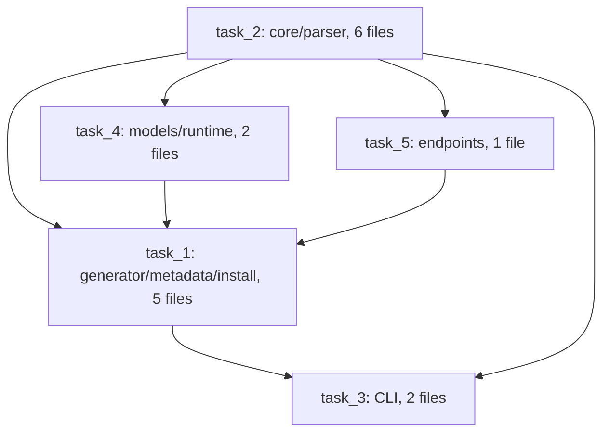

# D052 / D053 — decomposition diagnostic status

Date: 2026-10-10. Final status: all generation, grading and the separate Opus monitor completed. Neither condition achieved complete task success. Earlier stage notes below are chronology; the terminal section supersedes pending statements.

## Observed attempts

| Condition / attempt | Observed status | Planning calls | Input tokens | Planning API-equivalent USD | Independent grade |
|---|---|---:|---:|---:|---|
| D052 decomposition01 | Local budget lock before inference | 0 | 0 | 0 inference cost | Not graded |
| D052 decomposition02 | Correction limit; no worker | 7 | 217,323 | 0.1303938 | 0/63 |
| D053 anchored decomposition01 | Valid plan, core completed, then local payload-size rejection | 30 planning calls + 1 worker | See final event receipts | 5.0727238 all calls | 0/63 incomplete candidate |
| D052 prepared01 | REPAIR_TARGET_UNRESOLVED | 6 total calls | See final event receipts | 5.8558162 all calls | 62/63 |
| D054 continuation | First decision HTTP400; no worker | 1 failed decision | Unknown | Unknown; net charge refunded | 0/63 |

D05202 run wall was 11,059.052458 ms; 33 validation issue records became 18 after one correction, but the plan remained invalid. [D052 record](../decisions/D052.md) and [D053 design](D053_DESIGN.md) preserve exact issue categories and the validator correction. D05201's local lock is retained as an attempt; it generated no paid inference. These failures must remain visible in development totals rather than being erased by a later successful plan.

The D052 estimate is the sum of `invocation_finished.api_equivalent_usd` in `benchmark-runs/d052-decompose-02/events.jsonl`, equivalently 217323 / 1000000 × 0.6 USD. It is an informational input-token valuation, not an invoice. Monthly subscription allocation and reused architecture generation cost remain unknown.

Initial D053 run wall: 817,853.028958 ms. Its core worker used 769,607.374375 ms and USD4.5588292 API-equivalent. The next decision was rejected locally before inference because its payload exceeded the local limit. This is a controller payload failure after successful implementation work, not a provider response failure. The prepared run used 1,124,604.827542 ms and stopped after public default-list/literal-boolean observations could not be assigned an unambiguous repair target. Independent grade passed 62 of 63 tests. Evidence is each run's `result.json`, `invocation_finished` events and `benchmark-runs/d052-grade-prepared/result.json` / `benchmark-runs/d053-grade-decompose/result.json`.

D054 must retain the D053 USD5.0727238 and elapsed stage, count reused core implementation once, and measure original D053 start through final grade including controller repair pause. The failed D052 planning USD0.1303938 stays separate from arm comparison but included in development total. Reproduction after continuation ends: `python3 scripts/analyze-d054-continuation.py benchmark-runs/d054-protocol.json --output benchmark-runs/d054-analysis-final.json`. The protocol must list the D053 `parent_path` for the D054 condition and `development_history` for failed D052 planning. The script separately reports active stage time and continuous elapsed time; it imports existing grade/provenance checks and preserves unknown billing.

## D053 completed planning stage

`benchmark-runs/d053-decompose-01/decomposition.json` reports **30 decisions, 47,537.726958 ms planning wall, five tasks, 16/16 owned files and 20/20 accountable requirement IDs**. These measurements end at plan construction; they do not measure candidate completion or prove parallel execution.

Jev selected ownership from an unowned shared architecture catalog. This grouping was not supplied as a prepared candidate. The catalog itself is reused historical design, so the experiment evaluates allocation and execution conditional on those paths/interfaces. It does not measure unrestricted architecture invention or recursive splitting.

Requirement accountability is separate from file contributions: each worker implements every owned file's purpose and the relevant portions of shared requirements even when another worker is accountable. Final delivery checks need all required artifacts; they are not automatically implementation dependency edges.

## Original reporting gate (completed below)

Await D054 continuation terminal state, freeze and independently grade its candidate. Then aggregate all planning, execution, repairs and failures; distinguish run wall from start-through-grade time and actual worker overlap. A valid five-task graph cannot establish an efficiency improvement. Prepared and anchored routes have different planning scaffolding, disclosed in the protocols; no identical-judge-only causal claim is allowed.

## Terminal comparison — D054 included

Source: `benchmark-runs/d054-analysis-final.json`, produced by the continuation analyzer command above. Each stage contributes its receipts once; the core worker is not charged twice.

| Metric | Prepared D052 | Anchored D053 + D054 |
|---|---:|---:|
| Independent tests passed | 62/63 | 0/63 |
| Controller invocations | 6 | 32 |
| Implementation workers | 4 | 1 initial + 0 continuation |
| Active stage run time | 1,124,604.827542 ms | 822,498.732792 ms |
| Original start through final grade | 1,148,150.164 ms | 1,095,383.928 ms |
| Continuation gap, included above | 0 | 260,814.267208 ms |
| API-equivalent total | USD5.8558162 | Unknown; known subtotal USD5.0727238 |
| At least two worker processes overlapping | 162.16999983787537 s | 0 s |

The overlap source is `benchmark-runs/d054-overlap-final.json`: controller process intervals only, not productive work or provider GPU utilization. Failed incomplete work finishing earlier cannot support an efficiency gain. The analyzer suppresses both completion-time and cost-reduction ratios. Timing uses monotonic stage durations and wall-clock original-start timestamps; small clock differences are retained in their separate fields.

**Final failure:** D054's first decision returned HTTP400 with provider run ID `69f87609-671b-485e-be21-f56ef51b9b63`. No new worker ran. The raw error body was discarded; a context-size, schema or provider-model cause is therefore not established. The provider's failed-row refund/no-charge evidence and account reserved-zero state were recorded under `benchmark-runs/d054-reconciliation/`, and the shared ledger settled at **1,437,350/10,000,000 charged input tokens, reserved0, pending0, settled100**. Confirmed zero net charge is distinct from unknown usage/API-equivalent valuation; historical failed receipt fields remain null.

**Costs:** known compared-condition subtotal is USD10.92854. Adding failed D052 planning USD0.1303938 yields **USD11.0589338 known development API-equivalent subtotal**, plus unknown D054 failed-call valuation. Separate Opus monitor completed at **USD0.071498**, so including it gives **USD11.1304318 known subtotal plus the same unknown**. These are not subscription invoices. Reused architecture generation and monthly allocation remain unknown.

The monitor's 30-versus31 call observation is a scope distinction: D053 planning alone had30 calls and USD0.5138946; one core worker added USD4.5588292, producing31 total calls and USD5.0727238. Its packet lacked the overlap artifact, so the measured parallel interval above supersedes its uncertainty. The monitor is an additional review, not authority for new execution.

## Controller defects and next unresolved work

- D052 scheduling conflated delivery evidence with implementation prerequisites, while unconstrained ownership also allowed empty or irrelevant assignments. D053 addressed this with anchored feasible allocation and separate delivery checks.
- D053 accumulated enough decision context to exceed its local payload byte limit after core implementation. D054 changed representation and resumed the core, but the next provider request still failed; these are distinct failures.
- Prepared execution detected public generated-code problems but could not determine a safe repair target and stopped. That routing boundary remains unfinished.
- The client discarded the HTTP400 error body. The exact provider rejection cause cannot be reconstructed from the status code and run ID alone.

No further call was replayed automatically. Next work requires evidence-based error diagnosis and repair-owner routing; it is not proof that more task splitting improves completion. All generation and monitoring finished; grader containers were removed. Logs, candidates, reconciliation evidence and uncommitted changes remain. No commit/push or original Personal OS modification occurred.

Final controller suite: `npm test` passed561/561, fail0, skipped0; preserved at `benchmark-runs/d054-preflight/full-tests.log`. This does not change the live incomplete grades above.
