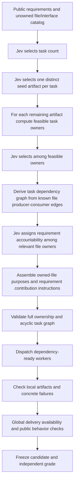

# D053 — anchored ownership with separate delivery checks

Date: 2026-10-10. Owner: decomposition_fixture. Status: implementation design; no D053 performance measurement in this document.

## Measured D052 failure

`benchmark-runs/d052-decompose-02/events.jsonl` contains seven `inference_finished` and seven `budget_settled` events. Jev chose five tasks. Two ownership/dependency plans failed structural validation, and no implementation worker started. The run stopped with `DECOMPOSITION_CORRECTION_LIMIT` after 11,059.052458 ms according to `result.json`. This is planning overhead for an unsuccessful attempt, not completed-task latency.

| Validation issue | Initial plan, revision 0 | Correction, revision 1 |
|---|---:|---:|
| Empty requirement task | 1 | 0 |
| Empty file task | 1 | 1 |
| Accountable owner has no relevant file | 1 | 2 |
| Requirement artifact unavailable under old prerequisite rule | 23 | 11 |
| Missing known artifact dependency | 7 | 4 |
| **Total issue records** | **33** | **18** |

These are issue records, not independent defects or failed tests. Repeated references to the same unavailable file count separately. Neither emitted task DAG was itself flagged `cyclic_dependencies`. However, file ownership made required implementation dependencies incompatible with the chosen DAG: in revision 1, task 3 owns IR and the generator while task 4 owns model rendering and typecode; model rendering needs IR while the generator needs model rendering. Adding both necessary cross-task directions would create a cycle.

Reproduce the counts from the repository root:

```sh
node --input-type=module -e '
import fs from "node:fs";
const p="benchmark-runs/d052-decompose-02/events.jsonl";
const rows=fs.readFileSync(p,"utf8").trim().split("\n").map(JSON.parse);
for(const r of rows.filter(r=>r.event==="decomposition_validated")) {
 const counts={}; for(const i of r.issues) counts[i.id]=(counts[i.id]??0)+1;
 console.log({revision:r.assignments.revision,total:r.issues.length,counts});
}
'
```

## Correction to our D052 contract

D052 asked for requirement owners, file owners and dependency directions as largely independent decisions, then attempted to repair the combined graph. This permitted empty task identities and incompatible file/dependency assignments.

Our validator also interpreted every `required_artifacts` entry as a mandatory implementation predecessor of the requirement owner. That conflated two different constraints. A cross-cutting behavior such as naming or model serialization can need several files to be present for final acceptance without requiring every other contributing implementation to finish before the accountable worker begins. This rule manufactured additional scheduling restrictions and must not be carried into D053 as an implementation dependency.

- **Implementation availability:** producer/consumer edges in the supplied file API contract determine when a worker can consume another worker's completed files.
- **Delivery availability:** all artifacts required to validate a requirement must exist before that requirement is declared fulfilled. They may be contributed by several workers without becoming artificial prerequisite edges to its accountable owner.

This correction does not establish that all D052 issues came from the validator. Empty owners, irrelevant owners and missing real producer/consumer dependencies were independently observed.

## Proposed D053 structure



No finished groups are enumerated beforehand. Jev selects task count and seed artifacts, then the owner of each remaining artifact. A seed gives a task a concrete identity and guarantees a nonempty file obligation. File paths and API edges still come from the disclosed reused D040 architecture; this is not free-form architecture invention.

The deterministic feasibility layer must reject an owner choice that would introduce an impossible quotient graph under the known file DAG. It must retain ownership already committed in earlier steps and ensure remaining unassigned files still admit completion. If the chosen task count or seeds leave no feasible completion, stop with a concrete infeasibility record or use an explicitly bounded planning correction. Never silently choose a different task count or regroup work. Single-option owner choices can bypass inference and must be recorded as deterministic choices.

The builder reports a v2 `runTaskDecomposition` implementation using `contracts/decomposition.v2.json`. Feasibility filtering applies to count, seed and subsequent file choices using bounded depth-first search capped at 10,000 states. Exhausting the search bound is an unknown result and stops planning, not proof of infeasibility. Infeasible choices are omitted; previously selected assignments are not overridden. This paragraph describes the coordinated implementation contract; independent verification results belong in the D053 verification record.

Task dependencies are derived in code from the known file producer/consumer edges after ownership. They are not separately guessed by pairwise Jev questions. Acyclic file graphs can become cyclic when arbitrary distant files are assigned to the same task, so checking only the original file graph is insufficient. Transitive reduction is optional and must preserve readiness semantics.

Requirement accountability follows file ownership. Candidate owners must own at least one relevant `artifact_paths` entry; global requirement R01 retains its documented packaging/entry-point accountability boundary. `required_artifacts` becomes delivery evidence, not added task dependency edges. Every requirement retains exactly one accountable task, but a useful implementation task may contribute files without being the sole accountable owner of a complete requirement. Forcing every task to own a whole requirement is unnecessary if its file contribution is explicit.

## Worker instructions

The assembled English instruction must state:

> Implement the complete documented purpose and shared interface contract of every file you own. Implement the portions of each relevant requirement contributed by those files, even when another task is the accountable owner of that requirement. Accountability does not make another worker solely responsible for all contributing files. Preserve the full public specification, acceptance criteria, original source references and shared interfaces. Write only your owned paths. Use predecessor artifacts as evidence; report missing delivery artifacts without treating an unexecuted final check as a confirmed implementation defect.

Each worker payload should include owned file purposes, contributed requirement IDs and text, separately marked accountable requirement IDs, producer references and allowed paths. A final evaluator must check complete delivery availability and behavior across all contributors; local implementation acceptance cannot alone mark a cross-cutting requirement fulfilled.

## Verification before inference

1. Distinct seeds produce nonempty file obligations; every file has exactly one owner and all IDs are valid.
2. Feasible owner enumeration excludes cycle-producing assignments and detects stranded remaining files; include the D052 IR/renderer/generator ownership conflict as a negative control.
3. Derived task dependencies preserve every cross-owner known producer/consumer edge and remain acyclic.
4. Requirement owners are relevant; delivery artifact references stay valid but do not manufacture implementation edges. Include a cross-cutting requirement spanning independent contributors.
5. Worker instructions preserve both owned-file purposes and contributed-but-not-accountable requirements.
6. Malformed responses, exhausted correction bounds and uncertain paid outcomes terminate without blind replay.
7. Actual dispatch respects accepted prerequisites and concurrency; final global checks preserve passed/failed/not-applicable/not-run distinctions.

## Scope, comparison and remaining boundaries

D053 is one-level decomposition with task count 1–5; it does not implement recursive task splitting or invent a new architecture. Existing worker model/effort, brief, verification and resource limits should remain matched. Because decomposition scaffolding changes, D052 is failed historical evidence rather than an identical-condition baseline. Preserve all D052 frozen files, failed-call costs and budget history. Report the extra sequential planning calls and time explicitly; successful graph construction does not establish end-to-end efficiency.

This document was written without paid calls, candidate execution, hidden grader inspection, original Personal OS changes or mutation of D052 evidence. Implementation status and D053 runtime measurements must be recorded separately after validation.
