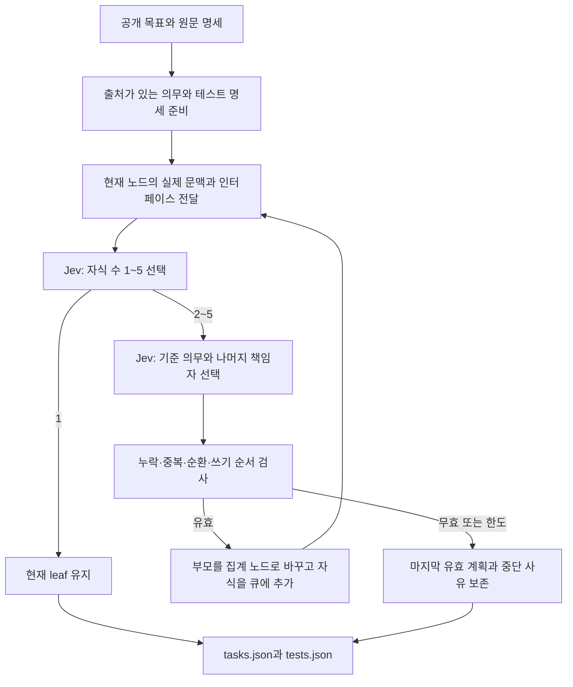

# D056 — 재귀 작업·테스트 계획 실행기

2026-10-10. 사용자 승인: D055의 작업·테스트 목록과 반복 분할 방식으로 진행. 실제 실험 상태와 수치는 [D056 기록](../decisions/D056.md)을 따른다.

## 연결된 흐름



정본 질문은 [recursive-task-tests.v2.json](contracts/recursive-task-tests.v2.json)에 있다. 반복마다 LLM이 질문을 다시 작성하지 않는다. `child_count`, `anchor`, `assign_obligation`만 실호출하며, 테스트 참여 작업과 통합 범위는 확정된 의무 소유권에서 코드로 계산한다. 계약에 남긴 `test_scope` 질문은 예약 항목이다.

Jev는 숫자와 ID를 선택한다. 새 작업 설명과 테스트 코드를 자유 서술로 만드는 역할이 아니다. 코드가 선택된 원문과 준비된 예상 동작을 연결한다. 사전 원문 분해와 테스트 설명 준비는 별도 작업이며, 이번 공급자 호출 장부에 그 개발 시간·토큰이 포함되지 않는다.

## 입력과 출력

[공개 입력 fixture](../../benchmarks/e2e-swe/manifests/d056-obligations.json)는 원문 20개 절을 출처가 있는 80개 문장·행동 단위로 준비하고, 80개 개별 테스트 명세와 5개 교차 명세를 붙인다. [입력 설명](D056_INPUTS.md)과 생성 스크립트가 정확한 행·바이트·해시를 관리한다. 미리 작업 그룹이나 책임자를 지정하지 않는다. 다만 이 준비된 단위보다 더 작은 의미 단위를 자동 생성하는 기능은 없다.

`tasks.json`은 부모·자식, 원문 의무, 입출력, 잠재 수정 범위, 알려진 의존 관계, 테스트 연결, 공유 파일 순서와 검토 출처를 가진다. 부모를 쪼개면 집계 노드로 바꿔 자식과 중복 실행하지 않는다. 단일 후보인 경우에는 모델을 부르지 않고 그 이유와 모델의 적절성 판단이 없었다는 사실을 남긴다.

`tests.json`은 실제 입력·예상 결과를 보존한다. 여러 leaf에 걸친 검증은 통합 범위로 남기고, 원래 전체 동작 검증을 낮은 범위로 바꾸지 않는다. 모든 `runner_ref`는 `null`, 상태는 `not_run`이다. 현재 계획 실행기는 제품 테스트를 실행하지 않는다.

모든 작업은 `execution_eligible:false`다. `ready_specification_only`와 실행기 전체 `complete`는 계획 상태이며 제품 완료가 아니다. 공유 파일에 대해서는 필요한 독점 쓰기 순서를 산출·검사한다. 실제 작업자에 잠금을 적용하는 실행 연결은 이후 단계다. 선언하지 않은 의존 관계는 독립성으로 해석하지 않는다.

## 보호 한도와 관측

최종 계획 한도는 깊이 4, leaf 32개, 판단 240회, 계획 입력 6M이다. 기존 누적 10M 장부를 그대로 사용한다. 초안의 계획 2M은 실호출 전 순차 배정 규모를 고려해 확장했다. 최적 작업 크기나 예상 사용량을 뜻하지 않는다. 동시 실행 2는 향후 자원 정책으로 전달하며, 이 실험에서 제품 작업자 2개를 실행했다는 뜻이 아니다.

한도에 도달하면 `partial`, 준비할 사실이 부족하면 `needs_spec`, 제공업체 실패는 `failed`로 남긴다. 검토하지 않은 leaf를 준비 완료로 바꾸지 않는다. `max_repairs_per_node`는 예약 설정이며, 현재 자동 수정·재전송은 구현하지 않았다.

요청마다 실제 전달 JSON, 응답, 이벤트, 영수증을 별도로 보존한다. 첫 호출 전에 모델 목록 GET을 수행한다. HTTP 시간은 요청 전송부터 응답까지이며, 계획 전체 시간에는 목록·잔액 조회, 장부, 구조 검사와 기록도 포함한다. 실패 토큰은 반환되지 않으면 `null`이다. 환불 확인은 추론 토큰 0과 다르며 별도 정산 증거를 남긴다.

D056C의 `columnar_text`는 같은 구조의 레코드를 공통 열·행·공통값으로 표현하고, 정확히 반복되는 문자열만 참조한다. 열 이름과 해석 지시는 영어로 요청 안에 포함한다. 매 요청에서 복원한 전체 state를 원래 state와 비교한 뒤 전송한다. 이 검사는 정보 보존을 확인하며, 모델의 이해·정확도까지 증명하지 않는다. 모델 입력 한도 초과 응답 때문에 추가한 호환성 조건이다. 원래 객체·JSON 문자열 조건은 과거 재현용으로 남긴다.

월정액 청구액을 호출 비용으로 나누지 않는다. 토큰 팩 기준 USD 환산은 비교 참고값이며 실제 청구액과 분리한다. [가격 출처](https://jev-ai.pro/pricing)는 실험 manifest에 확인일과 산식을 고정한다.

## 재현 명령

저장소 루트에서 실행한다. `--spend`가 없으면 키를 읽거나 추론하지 않고 입력을 검사한다. 실행 디렉터리는 새 이름이어야 한다.

```sh
node scripts/build-d056-obligations.mjs --check
node scripts/inspect-d056-codec.mjs
npm test
node scripts/recursive-task-tests-pilot.mjs

# D05601: 객체 state 조건. 실제 HTTP400 실패 기록을 보존한다.
node scripts/recursive-task-tests-pilot.mjs --spend \
  --output benchmark-runs/NEW_OBJECT_RUN

# D056B: 동일 state를 완전한 compact JSON 문자열로 전달하는 별도 조건.
# 원문/테스트 값을 생략하지 않으며 JSON.parse로 같은 값인지 검사한다.
node scripts/recursive-task-tests-pilot.mjs --spend \
  --manifest benchmarks/e2e-swe/manifests/d056-planning-json-text.json \
  --output benchmark-runs/NEW_TEXT_RUN

# D056C: 동일 사실을 공통 열과 정확한 참조로 전달하는 별도 조건.
node scripts/recursive-task-tests-pilot.mjs --spend \
  --manifest benchmarks/e2e-swe/manifests/d056-planning-columnar.json \
  --output benchmark-runs/NEW_COLUMNAR_RUN

node scripts/analyze-recursive-planning.mjs benchmark-runs/RUN_ID --write
node scripts/monitor-d056.mjs --spend benchmark-runs/RUN_ID
```

`--mock`는 명시적인 가짜 응답 구조 검증이다. 모의 분할 개수·시간을 Jev 성능으로 보고하지 않는다. 마지막 명령은 별도 Opus 5.5 medium 모니터 호출이며 비용을 분리한다. 키는 기존 `~/workspace/.env`의 `JEV_AI_API_KEY` 또는 서버 환경변수에서만 읽는다. 배포에는 서버 비밀 환경변수를 설정한다.

## 아직 확인하지 않은 효과

계획 목록의 의미상 적절성, 실제 테스트 결함 검출력, 작업자 병렬 실행, 통합 비용, 전체 완료율·속도·비용 개선은 이 구현과 별개다. 동일 목표·독립 평가·작업자 프로필로 실제 구현까지 수행해야 비교할 수 있다. 코드 검증, 모델 응답 성공, 계획 유효성, 제품 성공을 서로 대신하지 않는다.
