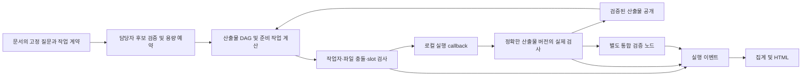

# D064 — DAG 기반 로컬 개발 및 스킬 관리

2026-10-10. 사용자 지시: 스킬 관리 담당 에이전트 한 명을 추가하고 다음 개발 순서를 병렬로 시작한다.
[역할·파일 소유권·공통 인터페이스](../agents/D064_PARALLEL.md), [D063 계획](D063_DAG_PLAN.md).

상태: **별도 opt-in 로컬 DAG 기반 구현·통합 검증 완료. 공개 제품 검사 연결은 36/85로 부분 완료이며 실제 제품 실행은 차단된다.** [구조화 결정 기록](../decisions/D064.md), [독립 검토](../agents/D064_REVIEW.md), [측정 집계](../../benchmark-runs/d064-local/summary.json).
과거 실행기/질문/실험 원본과 예산 장부를 유지한다. D063의 전체 제품 통합 및 동일 조건 성능 비교까지 완료했다는 뜻이 아니다.

## 이번 연결 범위

- P0: [계약 검증기](../../src/orchestration/dag-contracts.mjs), [JSON schema](contracts/artifact-dag.v1.schema.json), [공통 fixture](../../examples/dag/contract-fixture.json), 공개 명세 85개 전수 감사. 실제 검사는 36개 ID만 연결했다. JSON schema 전용 전체 엔진 검증은 실행하지 않았고 현재 의미 검사의 기준은 JS 검증기다.
- P1: [고정 영어 질문](contracts/dag-routing.v1.json)과 [어댑터](../../src/orchestration/dag-decision-adapter.mjs). 불가분 묶음·최소 배정·자격·잔여 용량을 정확 탐색해 가능한 담당자만 제시하며 선택마다 예약을 갱신한다. 탐색 한도 초과는 유효하다고 처리하지 않는다. 후보 하나는 로컬 선택이며 Jev 호출로 세지 않는다.
- P2: [산출물 DAG 분석](../../src/orchestration/artifact-dag.mjs)과 [스케줄러](../../src/orchestration/dag-scheduler.mjs). 산출물 producer에서 의미 간선을 만들고 파일 read/write 충돌은 별도 잠금으로 처리한다. 추정 임계 경로, unknown 시간/관계, 작업자·slot 제한, 필요한 선행 완료 즉시 해제를 구현했다. 작업 수에 작업자 최대 30 상한을 적용하지 않는다.
- P3: [검증 게이트](../../src/orchestration/artifact-verification-gate.mjs). 검사 ID/버전/환경과 정확한 입력·출력 revision 벡터, 실행 여부·assertion·종료값·skip·불확실 상태를 대조한다. 검증 전후 변경 또는 공개한 입력 버전과의 불일치를 거부한다.
- P4: [이벤트 집계](../../src/dashboard/dag-metrics.mjs)와 [독립 HTML](../../src/dashboard/dag-view.mjs). run/graph별 집계, 이벤트 중복/충돌 검사, 대기 원인·추정 CP·실측 완료시간을 분리한다. 기존 8787 대시보드에 실시간 연결한 것은 아니다.
- root 통합: [runArtifactWorkflow](../../src/orchestration/dag-workflow.mjs) → `runDag` → `executeArtifactTask`. 검증된 버전을 후속 소비 전에 고정·대조하고 종료 후 변경도 검사한다. 실행 ID 검증은 모든 작업보다 먼저 수행한다.



범위가 제한된 첫 버전이다. 완성된 생산 시스템, 자동 재귀 후보 생성, 모델 선택 후 실제 Claude dispatch, durable restart, OS 수준 파일 격리는 이번 로컬 callback kernel에 포함되지 않는다. 그런 기능을 false/null 플래그로 분리한다.
Jev 관계/분할/profile/failure 질문은 문서와 안전한 선택 검증의 정본으로 연결하되, 응답의 handler ID가 곧 제품 변경 권한이나 구현 완료가 아니다. 실제 동작하는 소유자 배정과 아직 제안 상태인 의미적 변경을 구분한다.

## 실제 실행한 검증

저장소 루트에서 실행했다:

```sh
npm test > benchmark-runs/d064-local/regression.log 2>&1
node scripts/dag-local-pilot.mjs benchmark-runs/d064-pilot-02
node scripts/audit-dag-public-checks.mjs
node scripts/audit-dag-public-checks.mjs --controls
```

- 전체 회귀: **993/993 통과**, 실패·생략 0, 25,662.971125ms. [원본 출력](../../benchmark-runs/d064-local/regression.log). 기존 테스트의 로컬 HTTP 수신을 허용한 검사다. 스킬 Python helper 6개는 별도 검사이며 993개에 더해 집계하지 않았다.
- 합성 DAG 실행 `d064-pilot-02`: **154.889334ms**, 실제 검사 subprocess **3/3 exit 0**, 구현 작업 최대 동시 **2개**. 측정 구간은 mock 소유자 배정 이후 workflow 호출부터 결과 반환까지다. 이벤트 기준 완료 구간은 `dag_plan_analyzed`→`dag_run_completed` **152.921ms**로 별도 지표다. [결과](../../benchmark-runs/d064-pilot-02/result.json), [검사 argv/출력](../../benchmark-runs/d064-pilot-02/subprocesses.json), [화면 파일](../../benchmark-runs/d064-pilot-02/dashboard.html).
- 실행 식별자는 goal `fixture-goal-v1`, graph `fixture-graph-v1`. 실제 환경은 Node v26.4.0/darwin/arm64이며 plan의 각 check에 버전·환경·명령을 기록했다. 고정 소스 **12/12**와 현재 소스 해시가 일치했고 실행 중 드리프트는 0개다. [프로토콜과 소스 사본](../../benchmark-runs/d064-pilot-02/protocol.json).
- **추정값**: fixture의 30/20/10ms를 사용한 CP는 **40ms**다. 임의 시간 모델이며 위 실측 또는 개발 효율 비교값이 아니다. 소유자 답은 `mock_choice_no_inference`, 모델 호출 0, `product_success:null`, 독립 제품 채점 `not_run`이다.

재현 시 pilot은 기존 evidence를 덮어쓰지 않도록 새 출력 디렉터리를 지정한다. API 키·모델을 사용하지 않는다. 합성 산출물 생성 callback 뒤 실제 Node 검사 프로세스를 실행하며 임시 작업 디렉터리는 종료 시 제거하고 evidence/HTML은 보존한다.

## 공개 제품 검사와 차단 상태

[공개 검사 디렉터리](../../benchmarks/e2e-swe/public-checks/README.md), [85개 전수 목록](../../benchmarks/e2e-swe/public-checks/inventory.json), [담당 결과](../agents/D064_PUBLIC_CHECKS.md).
36/85 ID를 4개 통합 suite에 연결했고 **49개 누락 ID와 이유**를 남겼다. 정상 대조 **4개/290 assertion** 통과, 의미적 결함 대조 **35개** 모두 지정된 ID에서 거부됐다. 하나의 boolean-default 결함이 두 ID를 다루므로 36개 독립 결함이라고 부르지 않는다. [대조 증거](../../benchmarks/e2e-swe/public-checks/results/d064-local-controls.json).

audit exit **2**는 의도된 `blocked`다. 정상 대조는 한정된 fixture renderer이며 실제 제품 후보를 검사한 결과가 아니다. 누락 mapping, 실제 후보 환경 미검증, artifact revision 어댑터 미연결의 세 차단 사유를 유지한다. 현재 공개 검사 evidence의 `artifact_revisions`는 `null`이다. 원문 명세와 D056 manifest 해시는 유지했다. 숨김 채점기·숨김 테스트를 읽거나 그 피드백으로 검사 기대값을 만들지 않았다.

## 발견한 결함과 정정

- **입력 revision 경쟁:** workflow 사전 검사와 gate snapshot 사이에 입력이 바뀌면 소비자가 미검증 버전으로 실행될 수 있었다. 초기 회귀는 6/7 통과·1실패였다. 검증된 `expected_input_artifact_revisions`를 gate에 전달하고 실행 전에 정확히 비교하도록 수정했다. 같은 독립 재현에서 소비자는 실행되지 않고 `ARTIFACT_INPUT_REVISION_MISMATCH`로 차단된다. 초기 실패 요약과 최종 회귀를 모두 보존했다.
- **실행 ID 사전 검사 누락:** 공백을 포함한 ID가 작업 실행 후 projector에서 거부됐다. 식별자 검사를 dispatch 전에 일치시키고 callback 이전 거부 회귀를 추가했다.
- **공개 검증 장치 오류:** macOS 임시 경로 alias 비교와 명시적 `importlib.util` 누락을 수정했다. strict P0가 registry의 추가 메타데이터를 거부한 연결 오류는 sidecar로 분리했다. 초기 감사 오류는 [원본](../../benchmark-runs/d064-local/public-mapping-audit.json)에 보존했고, 정정 뒤 정상/결함 대조와 full regression을 실행했다.
- **pilot 환경 표기:** pilot 01은 실제 Node v26.4.0 실행에 명목 Node 22 fixture 환경을 표시했다. [첫 실행](../../benchmark-runs/d064-pilot-01/result.json)을 유지하고 pilot 02에서 실제 환경과 12개 소스 사본을 기록했다. pilot 01을 제품 속도 증거로 사용하지 않는다.

## 스킬 관리

저장소 원본을 관리하는 담당 **한 명**을 배정했고, 이후에도 같은 유지보수 역할과 기록을 이어 사용한다. [새 관리 스킬](../../skills/jev-skill-maintenance/SKILL.md), [목록·5개 대기 항목](../skills/MAINTENANCE.md), [담당 상태](../agents/D064_SKILLS.md).
기존 `jev-decision-records`에는 DAG revision/실행 검사 근거 지침을 보완했다. 새 스킬에는 원본·설치 사본의 읽기 전용 비교 도구와 업데이트/신규 생성 판단 절차를 넣었다. 두 스킬의 구조 검사 및 helper **6/6** 통과, 독립 검토자의 실제 지침 적용을 확인했다. 호스트 자동 발견·자동 선택·사용자 생산성은 미검증이다. Codex와 Claude 진입점에서 같은 저장소 문서를 연결하며 전역 설치본은 수정하지 않았다.

## 다음 개발 순서

1. **공개 검사 담당:** 남은 49개 mapping과 각 정상/결함 대조를 완성한다. 고정 기대값과 독립 환경을 준비하고 누락을 일반 smoke 검사로 대체하지 않는다.
2. **런타임 담당, 1과 병렬:** 실제 candidate/checker/fixture/environment revision을 바인딩하고 snapshot/lease·실제 허용 경로를 구현한다. 선언 경로만으로 OS 격리가 됐다고 하지 않는다. 입력 변경 시 무효화, 불확실 외부 실행의 durable attempt/reservation 및 재시작 정책을 검증한다.
3. **판단·스킬 담당, 1–2와 병렬:** 분할·관계·프로필·실패 질문의 제안 handler를 실제 제한된 상태 변경에 연결한다. root count와 leaf 유지 정책을 별도로 고정하고 반복 운영에서 발견한 규칙만 기존/신규 스킬에 반영한다. owner 예약만 된 현재 상태를 자동 재귀 분해 완료로 처리하지 않는다.
4. 위 gate 이후 동일 DAG 실행기에 Claude/규칙/Jev 판단기와 기존 예산·계측 어댑터를 연결한다. 고정 작업자 모델·동시성·검사·환경·캐시·반복 수 조건을 사전 기록하고 전체 개발 완료시간/실패/비용을 비교한다. 기존 실패 응답을 새 질문의 성공으로 재해석하지 않는다.

이번 상태의 추가 유료 호출은 없고 실제 속도·비용 절감은 미측정이다. [보존 검사](../../benchmark-runs/d064-local/preservation.json)에서 기존 핵심 소스 7개와 예산 장부 해시가 유지됐다. original Personal OS/Vault, 이전 실험 원본, 기존 dashboard 실행 경로를 변경하지 않았다. 새 로컬 소스·문서·원본 출력과 `/tmp/d064-public-controls.json`을 남겼고, pilot sandbox는 제거했다. 커밋·푸시·전역 스킬 설치·새 컨테이너는 하지 않았다.
