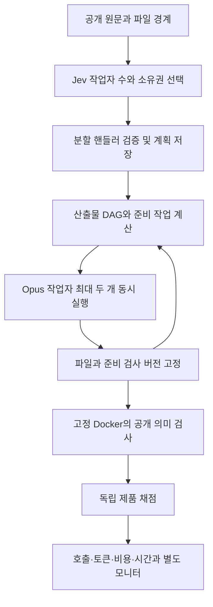

# D065 — 실제 실행기 연결과 테스트 정리

2026-10-10. 사용자 요청: 불필요하거나 과한 테스트를 병렬로 삭제하고, 남은 공개 검사·실제 파일/환경/버전 연결·분할/관계 실행 핸들러를 완성한 뒤 실제 실행기까지 역할을 나눠 진행한다.

2026-10-11 병렬 구현·실제 실행 종료. 제품 완료는 실패했다. 실제 Jev 배정에서16개 Claude 파일 작업·버전 고정·공개 검사까지 연결했고, 별도 독립 채점은62/63 통과였다. 정본 [실측 결과와 정정](D065_RESULTS.md), [역할·소유권·통과 조건](../agents/D065_PARALLEL.md), [실행 전 프로토콜](D065_EXPERIMENT.md). 기존 D064 결과와 D065 원본 실패를 보존한다. 처음 관측한 공개 mapping은36/85, 노드 회귀는993개였으며 이 수치가 현재 완료 수치는 아니다.

테스트 정리는 중복/구현 복제 검사만 대상으로 한다. 실제 알려진 결함을 잡는 유일한 검사는 유지하고 삭제 이유와 살아 있는 대체 증거를 연결한다. 공개 명세의 기대값과 실제 실행 검사는 coverage를 줄이기 위한 삭제 대상이 아니다.

실제 실행은 공개 검사·환경·revision 연결 및 독립 검토 이후 root가 새 프로토콜로 한 번 시작한다. 누적10M Jev입력 장부를 유지하고 불확실 요청은 자동 재전송하지 않는다. 구현, 로컬 정상/결함 검증, 실제 모델/제품 실행, 효율 비교는 각각 구분한다.

## 실제 연결 구조

1. 공개 원문과 D056의 출처 연결 요구사항·85개 검사 설명을 고정한다. 이번 조건의 시작 경계는 기존 문서에 있는16개 파일이다. 이 경계를 Jev가 자유 생성했다고 표현하지 않는다.
2. Jev가 작업자 수2..16을 선택하고 각 원자 산출물의 담당자를 선택한다. 전체 최대 작업자 정책은30이며, 실제 실행 slot은2다. 작업자 수와 작업 노드 수는 별개다. 후보 하나면 코드가 결정하고 Jev 호출에 더하지 않는다.
3. 의미 핸들러가 실제 선택으로 만든 분할을 검증·저장한 뒤 실행 계획에 반영한다. 필요한 요구사항·검사·산출물과 읽기/쓰기 경계, 순환 없음 조건을 보존한다. 원문에 명확한 의존 관계를 다시 묻는 유료 호출은 추가하지 않는다.
4. 파일 런타임이 선행 산출물 버전을 고정해 별도 staging에 전달한다. 작업자는 제한된 MCP 경로를 통해 파일을 읽고 쓰며, 각 파일의 기본 준비 검사가 통과한 뒤 공개된다. 기본 준비 검사는 Python/TOML/bash 구문 및 파일 존재 검사다. 모든85개 의미 검사가 선행 파일별로 통과했다는 뜻은 아니다.
5. 파일이 모이면 별도 검증 노드가 고정 Docker 환경에서 실제 설치와 공개 의미 검사를 실행한다. 검사 ID·버전·환경·fixture·정확한 산출물 revision을 증거에 연결한다. 불확실 시도는 자동 재시작하지 않는다.
6. root가 별도 독립 제품 채점과 Opus5.5 모니터 결과를 수집한다. 한 조건만으로 Claude 대비 속도·비용 개선을 계산하지 않는다.

관계 핸들러는 선택한 방향의 산출물과 실제 파일 binding을 요구하며 소비자의 읽기 범위까지 함께 갱신한다. 프로필·수리 핸들러도 제한된 상태 변경을 제공한다. 이번 실제 조건은 Opus5.5 medium 고정, 공개 실패 후 자동 수리0이다. 따라서 범용 재귀 후보 생성·동적 재계획·수리 성능을 측정하는 조건이 아니다.

## 검증된 담당 결과

- [테스트 정리](../agents/D065_TEST_TRIM.md): 세 파일67→55개,1,076→904줄,63,224→53,502바이트. 수정 후55/55 통과. 삭제 초기에는 같은 형식의 oracle 의미 변경과 일부 의무 누락 반례가 빠져 있었고, 독립 검토 후 기존55개 안에 복원했다. 전후 측정 시간이 병렬 작업 영향을 받으므로 속도 개선 주장을 하지 않는다.
- [파일 런타임](../agents/D065_RUNTIME.md): 실제 파일·Node 검사 subprocess 기반16/16 통과. 독립 검토에서 입력 변조의 늦은 거부와 unknown 상태 전달 오류를 발견·수정했다. 변조 후 소비 작업자 호출0회 및 worker/check 불확실 상태 전달을 별도 재현했다. 파일 권한과 감사만으로 OS 격리를 주장하지 않는다.
- [모델·스키마 검사](../agents/D065_PUBLIC_MODELS.md): 담당17/17 ID, 정상266 assertions, 허용 변형265 assertions, 결함17/17 감지. 이는 작성한 대조군 결과다.
- [HTTP 검사](../agents/D065_PUBLIC_HTTP.md): 담당17/17 ID, 정상459 assertions, 결함16/16 감지. 실제 생성 패키지의 동기·비동기 요청을 MockTransport로 확인했다. 원시 증거를 root의 `benchmark-runs/d065-preflight/public-http-controls.json`에 복사하고 해시를 기록했다.
- [단일 스킬 관리 담당](../agents/D065_SKILLS.md): 기존 스킬 두 개의 지침만 보완했다. 삭제 지도와 실제 결함/assertion 보존을 확인하고, 제안·계획 적용·실제 실행 증거를 구분하도록 했다. 새 스킬·전역 설치는 없다.

공개 통합 대조는7개 suite의 정상85/85, assertion2,216개, 의도한 결함81/81 검출로 끝났다. 고정 Docker 실행342.3666초, 컨테이너 제거 확인. [최종 원본](../../benchmarks/e2e-swe/public-checks/results/d065-local-controls.json), [담당 기록](../agents/D065_PUBLIC_CHECKS.md). 현재 소스31개 및 전체 공개 디렉터리42개 파일의 해시·크기를 동결했다. 이 결과는 작성한 대조군 검사이며 실제 생성 후보 통과가 아니다.

공개 검사 파일까지 포함한 삭제 대상4개 파일은 최종74→58개 테스트 정의,1,186→987줄,68,689→58,618바이트다. `sg --lang javascript --pattern 'test($NAME, $$$ARGS)' --json=compact`와 실제 파일 바이트를 이용한 [최종 집계](../../benchmark-runs/d065-local/test-trim-final.json)를 보존했다. 정리 직후982줄·58,088바이트에서 실제 설치 원본 오탐의 회귀 증거5줄·530바이트를 기존 검사 안에 추가한 단계도 구별했다. 새 런타임16개·핸들러8개·러너8개 검증을 포함한 마지막 `npm test`는1,009/1,009, 실패·건너뜀0,18,133.867375ms였다([명령과 해시](../../benchmark-runs/d065-local/regression-final-summary.json)). 전체 테스트 수 증가와 중복 정의 감소는 서로 다른 분모다.

[독립 검토](../agents/D065_REVIEW.md)에서 재현한 입력 변조의 늦은 거부, unknown 상태 전달, 관계 읽기 범위 누락, 실패한 작업자 수 응답 수용, 컨테이너 정리 불확실성 손실을 수정했다. 초기 검토에서 빠졌던 두 고유 반례와 공개 mapping 결함 검사는 삭제 후 남은 정의 안에 복원했다. 처음 통과했던 결과가 이 문제들을 충분히 검증했다는 뜻으로 쓰지 않는다.

root가 `node scripts/dag-e2e.mjs benchmark-runs/d065-live-01 --spend`를 실제 실행했다. Jev17회가 담당자2명과16개 파일의 소유권을 선택했고, 각8개 파일을 새 Claude CLI16회로 생성했다. 원본 시도는1,196.5148855초 뒤 `uncertain / DAG_PUBLIC_EVIDENCE_INVALID`로 끝났다. 생성된 엔드포인트의 문법 오류와, assertion0인 명확한 실패를 거부하는 실행기 결함을 함께 발견했다. 원본 [이벤트](../../benchmark-runs/d065-live-01/events.jsonl)·[배정](../../benchmark-runs/d065-live-01/allocation.json)·[결과](../../benchmark-runs/d065-live-01/result.json)는 변경하지 않았다.

원본 후보를 보존한 별도 독립 채점은62/63 통과·1개 실패였다. 실행기 수정 후 같은 실패 보고서를 재생하면 명확한 검사 실패로 종료하고 미확정 시도를 남기지 않는다. 원본에서 실행되지 않은 HTTP/CLI 공개 검사는 별도 진단으로 남겼으며, 후보 구문 오류와 검사기의 설치 경로/초기화 실패 처리 문제를 구별한다. 세부 시간·토큰·환산 비용·검사 정정의 검증은 [D065 결과](D065_RESULTS.md)가 정본이다. 성공 완료시간과 Claude 단독 대비 개선율은 측정하지 못했다. 새로운 유료 실행은 자동 시작하지 않는다.

설치 원본 검사 오탐을 수정한 공개 검사 v3는 별도 영수증으로 고정했다. 정상85/85·assertion2,216개·결함81/81 검출,297.635555초·정리 확인이며 [원본 v3](../../benchmarks/e2e-swe/public-checks/results/d065-local-controls-v3.json)를 현재 preflight가 사용한다. v2 원본과 실제 후보 실패를 교체하지 않았다. 마지막 회귀의 첫 sandbox 실행은 listener 권한 부족으로12개가 실패했고, 로그를 보존한 뒤 권한이 있는 환경에서 같은 suite를 통과했다. 알려진 문제 R1–R8은 독립 검토에서 수정 확인됐으며 제품의 생성 코드 결함은 남아 있다.
