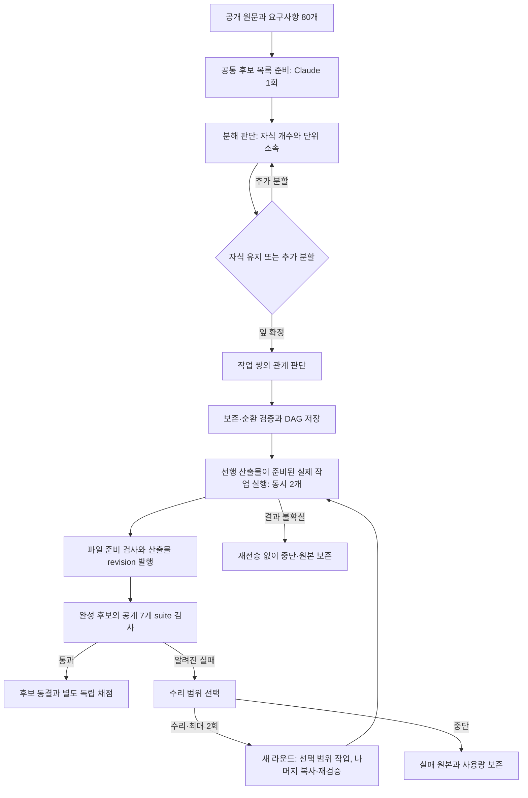

# D066 — 실행 가능한 재귀 계획과 공개 수리

2026-10-11 Asia/Seoul. [실험 조건](D066_EXPERIMENT.md), [역할](../agents/D066_PARALLEL.md), [독립 검토](../agents/D066_REVIEW.md), [현재 상태](../agents/STATE.md). 로컬 회귀와 실제 4조건 시도가 종료됐다. [실측 결과](D066_RESULTS.md): Claude 조건은 공개 85/85·독립 63/63을 통과했고 Jev 3조건은 분해 단계의 조건별 예약 상한으로 중단됐다. 관계·수리·개발 완료시간의 Jev 대비 효과는 미측정이다.



네 조건이 바꾸는 것은 분해·관계·수리의 판단 제공자다. 준비 후보, 질문·허용 동작, 작업 모델·노력도, 파일 도구, 검증은 같은 경로를 사용한다. 같은 제공자를 쓰더라도 실제 판단에 따라 트리와 DAG가 달라지므로, 관측된 시간 차이를 HTTP 전송 속도만의 효과로 해석하지 않는다.

- [planner](../../src/orchestration/adaptive-dag-planner.mjs)는 원문 인용·소유권을 검사하고 개수→소속→재귀 유지/분할→작업 쌍 관계를 묻는다. 선택은 실제 잎 작업의 산출물·읽기 범위와 선행 간선이 된다. [영어 질문 정본](contracts/adaptive-dag.v1.json)을 그대로 사용한다.
- [execution](../../src/orchestration/adaptive-dag-execution.mjs)은 기존 filesystem runtime 위에서 각 라운드의 산출물·검사 revision과 journal을 연결한다. 첫 공개 실패 뒤에도 나머지 suite를 수집한다. 수리한 파일과 변경하지 않은 소비자 파일은 새 조합으로 다시 검증한다. 복사된 파일을 모델이 다시 생성했다고 세지 않는다.
- [runner](../../src/benchmark/adaptive-dag-runner.mjs)는 기존 Jev client/측정/장부와 Desktop Claude CLI, 파일 MCP, 고정 Docker 검사를 연결한다. 원시 요청·응답·stdout·토큰/가격 영수증과 선택 이후 동작을 새 실행 폴더에 남긴다.
- [CLI](../../scripts/adaptive-dag-comparison.mjs) 기본 실행은 추론 없는 점검이다. [manifest](../../benchmarks/e2e-swe/manifests/d066-adaptive.json)는 4조건·공유 후보·예산·동시성·수리 한도를 고정한다.

```sh
# 추론 없는 현재 구성·장부 점검
node scripts/adaptive-dag-comparison.mjs

# root가 사전 검증·source 동결 후 실행하는 승인된 새 cohort
node scripts/adaptive-dag-comparison.mjs benchmark-runs/d066-catalog-01 --prepare-catalog --spend
node scripts/adaptive-dag-comparison.mjs benchmark-runs/d066-comparison-01 --catalog-preparation benchmark-runs/d066-catalog-01 --spend
```

실행 경로는 새 디렉터리여야 한다. 기존 실패/불확실 폴더를 다시 시작하는 명령은 아니다. 후보 생성 자체가 실패하면 원시 결과와 비용을 보존하며 공유할 정상 후보가 없는 상태로 비교를 시작하지 않는다. 최종 독립 채점은 root의 별도 단계이고, 그 숨김 내용은 수리 입력으로 쓰지 않는다.

입력/경로 검사와 단위 테스트 성공, 실제 제공자 호출 성공, 공개 후보 통과, 독립 제품 완료는 서로 다른 근거다. 단계별 실제 호출·선택·동작과 미도달 범위는 [D066_RESULTS](D066_RESULTS.md)와 보존된 원시 실행을 따른다. 이 구현은 반복 판단마다 새 질문을 생성하지 않지만, 단위별 순차 배정에서 큰 부모 문맥이 반복돼 Jev 조건의 계획 예산을 소진했다. 개선 제안은 다음 실험이며 종료된 실행을 재개하지 않는다.
