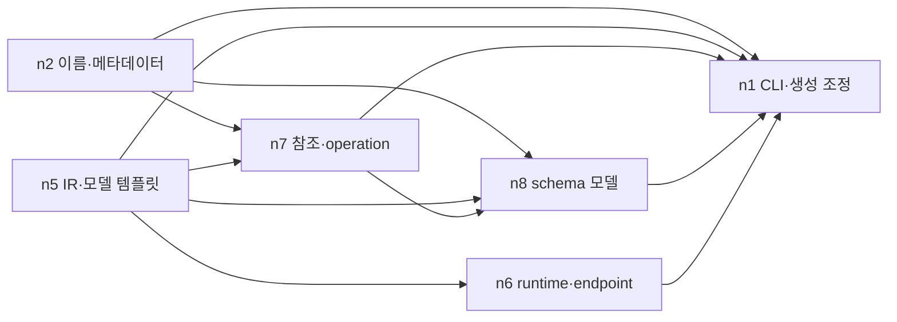

# D066 — OpenAPI Python client generator 실제 비교 결과

2026-10-11 Asia/Seoul. **4조건의 시도는 종료됐다. Claude 전체 판단 조건만 제품을 완성했고, Jev 3조건은 분해 단계의 입력 예약 한도에 걸렸다. 따라서 Jev의 개발 완료시간 절감률, 관계 판단 효과, 자동 수리 효과는 이번 실행에서 측정하지 못했다.** Cohort의 `completed`는 4개 시도의 종료를 뜻하며 4개 제품의 성공이 아니다.

사전 가설은 Jev가 반복 판단을 대신해 전체 개발 시간과 비용을 줄일 수 있다는 것이었다. 실제로는 현재의 순차 배정 질문과 분해 트리, 실험의 조건당 예산 배분이 맞지 않아 후속 비교 단계에 도달하지 못했다. 실패 원본과 비용을 보존한다. [실행 전 프로토콜](D066_EXPERIMENT.md), [구현](D066_IMPLEMENTATION.md), [결정 기록](../decisions/D066.md).

## 비교 결과와 시간 경계

공통 후보 준비 **187.283초 / API 환산 $0.481984 전액**을 각 조건에 더했다. 준비 호출은 실제 전체 지출에서 한 번만 센다. 시간은 준비와 각 실행기의 monotonic 경과시간 합이며, 사람이 후속 명령을 내리기까지의 공백은 포함하지 않는다. 독립 채점과 모니터는 별도다.

| 판단 제공자: 분해 / 관계 / 수리 | 최종 공개 검사 | 독립 제품 검사 | 준비 포함 시도시간 | 준비 포함 API 환산 | 결과 |
|---|---:|---:|---:|---:|---|
| Claude / Claude / Claude | 85/85 통과 | 63/63 통과, skip 0 | **42분 54.750초** | **$22.148223** | 제품 완료 |
| Jev / Claude / Claude | 미실행 | 후보 없음 | 4분 28.140초 | $0.8721466 | 분해 중단 |
| Jev / Jev / Claude | 미실행 | 후보 없음 | 4분 29.163초 | $0.8721466 | 분해 중단 |
| Jev / Jev / Jev | 미실행 | 후보 없음 | 4분 29.890초 | $0.8721466 | 분해 중단 |

근거: [후보 준비](../../benchmark-runs/d066-catalog-01/result.json), [4조건 원본](../../benchmark-runs/d066-comparison-01/result.json), [최종 분석 v2](../../benchmark-runs/d066-analysis-02.json), [독립 채점 요약](../../benchmark-runs/d066-comparison-01/claude_all/independent-evaluation.json). Jev 행은 **성공 완료시간이 아닌 실패 시도시간**이다. 성공 완료시간과 Claude 대비 절감률은 `null`이다. 낮은 실패 지출을 같은 제품의 비용 절감으로 해석하지 않는다.

Claude 실행 자체는 2,387,466.888958ms, 공통 준비를 더하면 2,574,749.648042ms다. 독립 채점 26,652.975791ms를 더한 측정 구간 합은 **43분 21.403초**다. 독립 채점 인계 대기 299,805ms는 별도로 기록됐으며 개발 시간에 섞지 않았다. 공통 준비를 4분의 1씩 배분하는 보조 회계에서는 Claude 40분 34.288초 / $21.786735지만, 이것을 실제 전 과정의 완료시간으로 쓰지 않는다.

이번 비교는 동일한 영어 질문·선택지·실행기에 Claude 또는 Jev가 답하는 구조다. Claude 판단마다 새 CLI 세션을 사용했다. 제한 없는 단일 Claude Code 세션의 일반적인 성능과 동일하지 않다. 조건당 1회, 고정 순서 실행이므로 공급자 부하·캐시·실행 순서의 영향을 분리하지 못했다.

## 실제로 실행한 범위

공개 원문에서 공통 후보를 새로 준비했다. **80개 요구사항, 21개 구현 단위, 22개 산출물, 38개 파일, 원문 인용 70개**다. 이전 16개 파일 설계나 완성 후보는 입력으로 사용하지 않았다. 준비 모델은 Opus 5.5 medium, 실제 준비 CLI 호출 1회다.

자유 재귀 분해는 이 후보 목록 안에서 개수·소속·유지/재분할을 선택하는 범위다. Jev가 자유 텍스트로 새 파일/API 구조를 발명한 실험은 아니다. 작업자 최대 30, 실제 구현 동시성 2, 깊이 최대 3, 공개 실패 수리 최대 2라운드로 고정했다. 질문의 답은 검증 뒤 실행 함수에 직접 연결되며 메인 에이전트가 답을 다시 판단해 바꾸지 않는다.

| 측정 단계 | Claude 전체 판단 | Jev 각 조건 |
|---|---:|---:|
| 분해 실제 제공자 호출 | Claude CLI 39회 | Jev POST 33회 |
| 관계 실제 제공자 호출 | Claude CLI 1회, 관계 질문 15개 | 0회, 미도달 |
| 최초 구현 | Claude CLI 6회 | 0회, 미도달 |
| 수리 범위 판단 | Claude CLI 1회 | 0회, 미도달 |
| 수리 작업자 실행 | Claude CLI 6회 | 0회, 미도달 |
| 위 단계 합계, 공통 준비 제외 | **Claude CLI 53회** | **Jev POST 33회** |

CLI 호출 수는 내부 턴·도구 호출·네트워크 시도 수와 다르다. Claude 내부 전송 재시도 횟수는 독립 측정하지 않았다. Jev 세 조건은 각각 분해 callback 34회 중 33회만 실제 POST됐다. 마지막 callback은 POST 전에 차단됐다. `planning.stats.provider_calls:34`를 실제 청구 호출 수로 쓰면 틀린다. 실제 제공자 receipt와 invocation-start 증거로 센다.

## Claude에서 확인한 분해·관계·수리

루트 21개 단위를 7/2/5/7로 나눴고, 5개와 7개 묶음을 다시 나눠 **최종 잎 6개 / 깊이 2**가 됐다. 각 단위와 요구사항의 소유권은 중복·누락 없이 유지됐다. 아래 단위/요구사항/파일 수는 각각 다른 분모다.

| 잎 | 담당 내용 | 단위 수 / 전체 21 | 요구사항 수 / 전체 80 | 파일 수 / 전체 38 |
|---|---|---:|---:|---:|
| n1 | 패키징·CLI·문서 로딩·설정·진단·생성 조정·hook | 7 | 22 | 10 |
| n2 | 이름 변환·프로젝트 메타데이터 템플릿 | 2 | 9 | 8 |
| n5 | 중간 표현(IR)·모델/enum 템플릿 | 2 | 2 | 5 |
| n6 | runtime·client·endpoint 템플릿 | 3 | 19 | 7 |
| n7 | 참조 해석·operation 파싱 | 2 | 4 | 3 |
| n8 | property·enum·union·default·model 파싱 | 5 | 24 | 5 |

관계 질문 15개에서 방향 관계 11개와 의존 없음 4개를 선택했다. 다음은 실제 선택한 실행 선행 관계다. 화살표는 선행→후행이며 최종 공개 검사는 모든 산출물을 기다린다.



실측 최대 동시 구현은 2개다. 기록된 작업 소요시간을 선택한 DAG에 가중치로 넣은 최장 경로는 두 라운드 모두 **n5→n7→n8→n1→공개 검사**였다. 최초 1,623,367.676459ms, 수리 339,632.82325ms다. 작업 검증 시간은 포함하지만 자원 대기 간선과 controller 사이 공백은 빠져 있으므로 최적 실행시간이나 잠재 가속률로 해석하지 않는다. 근거: 분석 v2의 `rows[0].execution.rounds[].timeline`.

최초 공개 검사는 7개 suite를 모두 실행해 **84/85 통과·1실패·미실행 0**이었다. 실패는 공개 `T.R10.02`: request body 인자 문서에 `The item body.`가 전달되지 않고 빈 문자열이었다. 수리 선택지는 실패 소유 n6만, 소유자와 소비자 n6+n1, 전체 잎, 중단이었다. Claude는 **`repair-all-leaves`**를 선택했다. 실제로 6개 작업자를 새로 호출했고 최종 **85/85 통과·미실행 0**으로 바뀌었다.

수리 뒤 바이트가 바뀐 산출물은 **3/22개(A07 IR, A14 operation 파싱, A19 endpoint 템플릿)**였다. 나머지 19개 산출물은 동일 revision이다. 6회 수리 호출 모두 새 파일 생성으로 세지 않는다. 수리 판단과 수리 작업자 API 환산 합은 $5.7937256다. 더 좁은 범위를 선택했을 때의 성공률·비용은 이번 실행으로 알 수 없다.

수리 작업자 n5의 범위 밖 읽기 2회는 `ARTIFACT_READ_NOT_ALLOWED`로 차단됐고 작업자는 복구해 완료했다. 이는 접근 경계가 적용된 도구 오류이며 전체 실행 실패가 아니다. 최종 후보를 수정하지 않은 채 별도 grader가 **63/63 통과·skip 0**을 확인했고, 해당 컨테이너는 제거됐다. 숨김 검사 세부 내용은 수리 입력으로 사용하지 않았다.

## Jev 세 조건이 같은 곳에서 멈춘 원인

직접 원인은 API 장애나 10분 timeout이 아니라 **실험기가 설정한 조건당 700,000 입력 토큰 상한과 다음 요청 예약 65,536토큰**이다. 조건당 실제 사용 650,271에 다음 예약을 더하면 715,807로 한도를 넘는다. 남은 조건별 공간은 49,729지만 예약은 65,536이어서 15,807 부족했다. 마지막 허용 요청 전에는 631,624+65,536=697,160으로 한도 이내였다.

```text
루트 21단위 → split 4 → 18 / 1 / 1 / 1
첫 자식 18단위 → split 4 → 15 / 1 / 1 / 1
15단위 자식의 다음 분해 질문 → 예약 사전 검사에서 중단
650,271 + 65,536 = 715,807 > 700,000
```

이 700,000은 사용자의 누적 10,000,000토큰 한도 자체가 아니라, 제가 세 Jev 조건에 예산을 나눠 주기 위해 둔 **실험상 배분**이다. API가 정상 응답해도 이 상한 때문에 계획을 끝내지 못했다. 비교 목적에 충분한 계획 예산인지 사전에 입증하지 못한 실험 설계의 한계다. 중단 후 상한이나 답을 바꿔 같은 실행의 성공으로 이어 붙이지 않았다.

세 조건 모두 실제 33개 POST가 HTTP 200으로 응답·정산됐으며 조건당 입력 650,271·출력 1,740토큰이다. 유료 소속 질문 **31/31개가 `child_1`**을 선택했다. 각 부모의 첫 단위는 로컬에서 child 1에 배치되고 마지막 세 단위는 비어 있는 child 2/3/4를 채우도록 강제됐다. 첫 묶음 집중은 실제 선택 기록이며, 단위 개수가 작업 난이도나 부하량과 같다는 뜻은 아니다. 다음 34번째 callback은 요청 파일 저장과 장부 예약·전송 전에 차단됐다. 질문 자체는 이벤트에 보존됐다.

[독립 구조 감사](../../benchmark-runs/d066-review/audit-jev-split-planning-cap-20261011.json)에서 세 조건의 순서별 요청 파일 **33/33 바이트 일치**, typed 선택 **33/33 일치**, 로컬 선택을 포함한 44개 결정과 미완성 트리의 일치를 확인했다. 공급자 원시 응답의 확률 수치는 달랐으므로 전체 응답이 같았다고 하지는 않는다.

소속을 한 단위씩 순차 질문할 때 큰 부모 근거를 반복 전달했다. 한 조건의 33개 compact 요청 총 **1,781,829바이트** 중 다음 네 state 값이 **1,719,252바이트(96.49%, 분모 전체 요청 바이트)**다. 이 값들은 root/child의 두 projection을 33번 전달했다.

| state 값 | 누적 직렬화 바이트 | 전체 요청 바이트 대비 |
|---|---:|---:|
| 요구사항 설명 | 936,825 | 52.58% |
| 단위·인터페이스 | 488,865 | 27.44% |
| 원문 근거 인용 | 169,776 | 9.53% |
| 산출물 | 123,786 | 6.95% |

전체 원문을 담은 `source` 필드는 없었고, tree 값은 개수 질문 두 개에서만 총 913바이트(0.051%, 같은 분모)였다. 따라서 주요 입력 중복을 전체 원문이나 트리의 반복으로 설명하는 것은 부정확하다. **바이트 분석은 필드별 제공자 토큰 측정이나 실현된 절감량이 아니다.** 큰 입력 자체가 불필요하다는 결론도 아니다. 사용자가 우선한 전체 작업 효율을 확인하려면 의미를 보존한 질문 묶음·예약·실행 가능한 계획의 비용을 함께 검증해야 한다.

단계 이벤트에서 관측된 분해 시도 구간은 Jev 조건 순서대로 51.190초, 51.551초, 52.205초다. 33개 Jev 호출 어댑터의 경과시간 합은 49.715초, 50.196초, 50.634초다. 이 receipt 시간에는 모델 목록 조회·예산 획득/예약·응답 저장 등이 포함돼 순수 POST 지연이 아니다. Claude의 분해 39개 CLI 경과시간 합은 290.724초다. **질문 수·실제 트리·완료 여부가 다르므로 이 수치로 같은 판단의 가속률이나 개발 완료 가속률을 계산하지 않는다.** Jev 나머지 실행시간에는 환경 사전 검사 등이 포함된다.

관련 원본: [첫 Jev 계획](../../benchmark-runs/d066-comparison-01/jev_split/planning.json), [세 조건 중 마지막 결과와 장부](../../benchmark-runs/d066-comparison-01/jev_all/result.json). `leaves:[]`는 완료·commit된 잎 목록이 없다는 뜻이며 잠정 트리가 전혀 만들어지지 않았다는 뜻은 아니다.

## 토큰과 가격

2026-10-11 확인한 [Claude 공식 단가](https://platform.claude.com/docs/en/about-claude/pricing)와 [Jev 공식 가격](https://jev-ai.pro/pricing)을 적용했다. Opus 5.5 입력 $4/M·출력 $20/M·1시간 캐시 생성 $8/M·5분 생성 $5/M·캐시 읽기 $0.20/M. 이번 Claude 캐시 생성은 모두 1시간 TTL이었다. Jev는 기존 비교 정책인 15M/$9, 입력 $0.60/M·출력 무료를 사용했다. [확인 기록](../../benchmark-runs/d066-preflight/official-api-pricing.json).

| 측정 범위 | 일반 입력 토큰 / 환산 | 출력 토큰 / 환산 | 캐시 생성 토큰 / 환산 | 캐시 읽기 토큰 / 환산 | 합계 |
|---|---:|---:|---:|---:|---:|
| Claude 조건 + 공통 준비 | 212 / $0.000848 | 316,677 / $6.333540 | 1,883,024 / $15.064192 | 3,748,215 / $0.749643 | **$22.148223** |
| Jev 조건당, 공통 준비 제외 | 650,271 / $0.3901626 | 1,740 / $0 | 미제공 | 미제공 | **$0.3901626** |
| 별도 Opus 모니터 | 2 / $0.000008 | 2,294 / $0.045880 | 2,951 / $0.023608 | 0 / $0 | **$0.069496** |

Jev의 캐시 사용량 미제공을 0으로 보간하지 않는다. 서로 다른 공급자의 토큰량을 같은 tokenizer 단위로 비교하지 않는다. **모든 금액은 공식 단가 기준 API 환산이며 실제 월 구독 청구액이나 추가 결제액이 아니다. 실제 청구 배분은 `null`이다.**

Claude 조건의 공통 준비 제외 단계 비용은 분해 $5.5650872, 관계 $0.4492924, 최초 구현 $9.8581338, 수리 판단 $0.782144, 수리 작업 $5.0115816이다. 판단도 매번 새 세션을 만들고 큰 근거를 전달하므로 무료가 아니다. 캐시 생성 $15.064192가 발생한 원인은 실제 receipt의 1시간 캐시 생성 토큰에 공식 $8/M을 곱한 값이다. 캐시를 끄거나 공통 prefix를 재사용했을 때의 절감액은 측정하지 않았다.

전체 cohort는 공통 준비를 한 번 포함해 **Claude CLI 54회 + Jev POST 99회 = 153회**, 환산 **$23.3187108**다. 별도 모니터 1회를 더하면 154회, **$23.3882068**다. 네 표 행을 단순 합하면 공유 준비를 3번 중복 계산하므로 실제 전체 지출이 아니다.

누적 Jev 입력 장부는 **7,633,742→9,584,555 / 10,000,000**, 이번 증가 **1,950,813=650,271×3**, 잔여 **415,445**, pending/reserved 0이다. 기존 ID와 정산 이력을 유지했다. 근거: [시작 snapshot](../../benchmark-runs/d066-comparison-01/claude_all/budget-before.json), [종료 snapshot](../../benchmark-runs/d066-comparison-01/jev_all/budget-after.json). 장부를 초기화하거나 예산을 늘리지 않았다.

## 검증·정정과 독립 모니터

실행 전 전체 회귀는 **1,026/1,026 통과, 실패·취소·skip 0**, 39,416.330458ms다. [명령·원본 로그 해시](../../benchmark-runs/d066-preflight/regression-summary.json). 공개 검사 정상·결함 대조는 실행 전 검증이고, 위 85/85는 실제 생성 후보 검사다. 최종 독립 63개 검사는 또 다른 근거다.

[독립 원시 근거 감사](../../benchmark-runs/d066-review/final-independent-audit-01.md)는 공통 source pin 55개와 각 조건의 추가 준비 pin, 원본/현재 바이트 총 566개 대조, 분석 입력 해시 285개를 확인했다. 변동은 없었다. Claude 38개 최종 파일은 독립 채점 전후와 현재 바이트까지 같고, 공개 검사 두 라운드의 22개 산출물 revision과 실제 소비 관계도 일치한다. 이 해시 대조는 추가 제품 테스트 건수가 아니다.

Jev 요청 모델은 모두 `jev-latest`지만 실제 응답에는 `typesafe-ai/jev`, `jev-1.13.0`, `typesafe/jev-1.13-20260917`의 세 이름이 기록됐다. 허용된 응답 이름을 보존했고, 공통 alias만으로 보이지 않는 backend 모델이 동일하다고 입증하지 않았다. 별도 HTTP receipt의 `durationMs` 합은 각 조건 26.911/27.937/28.113초이며 모두 POST·HTTP 200·자동 재시도 0이다. 이 시간도 위 어댑터 시간·전체 완료시간과 구별한다.

자체 검증에서 발견한 정정도 남긴다. 유료 호출 전 catalog/파일 도구의 경로 계약 불일치와 readiness argv의 줄바꿈 제약을 수정했다. 실행 후 첫 분석 v1은 Jev에 없는 `adaptive_provider_started` 이벤트를 경계로 사용해 시작을 늦게 잡았다. **분석 v2는 실제 decision request부터 마지막 selection/failure까지로 고쳤다.** [분석 v1](../../benchmark-runs/d066-analysis-01.json)을 남겼고 실행 원본·후보·영수증은 수정하지 않았다. 조건 전체 monotonic 시간과 가격에는 영향이 없다.

별도 **Opus 5.5 medium 모니터 1회**, 27,649.946125ms, 환산 $0.069496, 결과 `attention`을 확인했다. [모니터 원본](../../benchmark-runs/d066-monitor-numeric-01/result.json). 네 조건의 숫자 요약만 받아 계산·해석 범위를 검토했다. raw 질문/답/소스/검사 binding을 읽은 독립 감사로 확대하지 않는다. 누적 장부를 모니터에 보내지 않아 보고서의 잔액 `unknown`은 모니터 입력의 한계이며, root는 위 로컬 장부로 확인했다. 모니터가 준비 제외 80.9–82.6초를 Jev phase로 표현한 부분은 환경 사전 검사까지 포함하는 **조건 전체 실행시간**으로 바로잡는다.

첫 모니터 전송은 내부 경로·소스 식별자·실행 메타데이터의 외부 전송 승인 부족으로 자동 승인 검토에서 거절돼 시작되지 않았다. 이를 제외한 수치만 담은 새 패킷을 다시 검토받아 승인된 호출을 실행했다. 거절된 원래 패킷을 우회 전송하거나 자동 재호출하지 않았다.

## 재현·열람

아래는 **이미 실행한** 명령이다. 앞의 `--spend` 두 명령은 유료 실행 기록이며 반복 실행 지시가 아니다. 원본 폴더는 재사용하지 않는다. API 질문/답은 각 조건의 `calls/*.request.json`, `calls/*.response.json`, 사용량은 `receipts/`, 단계 이벤트는 `events.jsonl`과 Claude `stdout` 기록에서 볼 수 있다. 키·Authorization 헤더는 저장하거나 출력하지 않는다.

```sh
node scripts/adaptive-dag-comparison.mjs benchmark-runs/d066-catalog-01 --prepare-catalog --spend
node scripts/adaptive-dag-comparison.mjs benchmark-runs/d066-comparison-01 --catalog-preparation benchmark-runs/d066-catalog-01 --spend
node benchmark-runs/d066-preflight/grade-condition.mjs --grade benchmark-runs/d066-comparison-01/claude_all
node benchmark-runs/d066-preflight/analyze.mjs benchmark-runs/d066-analysis-02.json
```

분석 출력은 새 파일만 허용한다. 재계산은 `d066-analysis-recheck.json` 등 아직 없는 경로로 실행하며 모델 호출이 없다. 문서 형식·source hash 검사는 다음 명령이다. 이 검사는 실제 주장이나 산술을 대신 검증하지 않는다.

```sh
python3 skills/jev-decision-records/scripts/check_record.py docs/decisions/D066.md --root .
git diff --check
```

## 남은 비교와 다음 조건의 제안

이번 결과만으로 Jev 관계 선택·공개 수리·제품 완성도·완료 속도 우위를 말할 수 없다. Jev 3조건이 분해 도중 동일한 예약 한도 중단을 공유했으므로 downstream 조건 차이를 관측하지 못했다. 자체 실행기의 Claude 기준선은 완성됐지만 일반적인 Claude 단독 사용 전체의 기준선은 아니다.

다음 수정 후보는 (1) 같은 부모 문맥에서 독립 가능한 배정 질문을 묶되 선택 간 의존성과 단위 보존을 검사하기, (2) 첫 묶음 집중을 감지해 실행 가능한 소속 선택지를 구성하기, (3) 분해 전에 필요한 호출·예약량과 관계/수리 몫까지 계산하기다. 원문·요구사항 의미를 줄이는 것보다 끝까지 실행 가능한 계획을 우선한다. 효과는 아직 가설이다. 바뀐 질문·선택지·상한을 사용한 결과는 새 실험으로 Claude와 함께 다시 측정해야 하며 이번 원본에 이어 붙이지 않는다. 현재 잔여 415,445토큰 안에서 가능한지 먼저 무과금 검사해야 한다.

원본 Personal OS/Vault와 과거 실험은 변경하지 않았다. 새 소스·역할/결정/결과 문서·실험 로그·생성 후보는 미커밋으로 남겼다. [종료 Docker 조회](../../benchmark-runs/d066-preflight/containers-final.jsonl)에서 D066 컨테이너는 남지 않았고 기존 컨테이너는 유지됐다. 전역 스킬 설치·Git 커밋·푸시는 수행하지 않았다. 실제 과정과 검증 결과는 이 로컬 기록에 있으며, 이 보고서만으로 기존 8787 대시보드에 새 실시간 연동이 추가됐다고 하지 않는다.
