# D069 — assertion 담당 연결과 산출물 단위 수리

2026-10-11. [실험 계약](D069_EXPERIMENT.md), [역할](../agents/D069_PARALLEL.md), [결정](../decisions/D069.md). 새 전체 실행과 독립 채점은 종료됐다. [실측 결과](D069_RESULTS.md): 공개85/85·독립63/63으로 완료됐지만 실제 수리0회다. 아래 수리 구현·오프라인 검증·별도 API 진단은 실제 수리 성공과 구분한다.

## 실행 연결

```mermaid
flowchart LR
  A[공개 검사 실패] --> B[원시 증거와 현재 binding 검증]
  B --> C[assertion → 요구사항 → 산출물 → 담당 task]
  C --> D[담당 산출물 또는 선언된 consumer 포함 후보]
  D --> E[v2 수리 질문 조립]
  E --> F[stage·요청 SHA·추정 토큰·전송량 검사]
  F --> G[Jev choice]
  G --> H[선택 후보와 산출물 권한 검증]
  H --> I[선택 작업자만 Claude 호출]
  I --> J[나머지 파일 바이트·mode·revision 상속 검증]
  J --> K[원래 로컬 검사와 공개 검사 전체 재실행]
```



1. `public-checks/assertions.json`이 현재 지원하는 compound assertion 4개의 안정 ID·요구사항·공개 인터페이스 경로를 정의한다. 실제 실패 뒤 실행되지 않은 assertion은 `not_reached`다. 기존 공개 case85개의 기대 동작·실행 순서·검사 버전3은 유지했다. 모든 assertion을 포괄했다고 주장하지 않는다.
2. `adaptive-repair-scope.mjs`는 원시 report의 계약 hash, 현재 plan/binding, 환경, checker pin, artifact revision과 evidence key를 대조한다. 실패 interface의 실제 소유자, 또는 선언된 consumer를 포함한 후보를 만든다. public-interface 담당은 원인 파일 확정과 다르다. 미매핑 증거는 task 전체 산출물 fallback으로 남는다.
3. `adaptive-artifact-repair-v2.mjs`는 v1 scope validator를 재사용한다. 선택된 요구사항·인터페이스·근거 원문, 후보 권한, 의존 artifact/소유자/경로, 실패와 검사 결과를 모델 입력에 보존한다. 반복 runtime/revision/check provenance는 controller hash 기록으로 옮긴다. 모델이 `context_ref`를 열 수 있다고 가정하지 않는다. 의존 인터페이스 상세는 실제 수리 작업자에게 전달한다.
4. case·invocation·descriptor의 반복 키는 `columns`/`rows`와 `details`로 표현하고, 정확히 같은 값만 공통 기본값으로 나눈다. 85개 case와 실패·미도달 상태의 값은 복원 검증한다. 알 수 없는 기본값 필드와 충돌하면 `ADAPTIVE_ARTIFACT_REPAIR_ENCODING_COLLISION`로 차단한다. 자료를 덮어쓰거나 길이에 맞추어 자르지 않는다.
5. `jev-token-admission-v2.mjs`는 trusted `stage`를 요구한다. split/relations는 기존 바이트 추정을 유지하고 repair에는 전체 전송량24,000B 운영 상한을 추가한다. 원문 request와 정책 SHA를 대조하고 budget 예약 전에 검사한다. exact model tokens는 null이며, 추정·byte 상한은 API 수락 보장이 아니다.
6. `adaptive-dag-runner.mjs`의 opt-in manifest v5가 이 구성을 연결한다. 기존 v1-v4 및 실패 진단 소스는 보존한다. 실제 worker의 MCP write 권한은 선택 산출물 경로로 좁힌다. runtime의 원래 DAG와 산출물 목록은 유지하고, 기존 나머지 산출물은 바이트·실행 mode·revision까지 검증한다. 선택되지 않은 완료 task는 provider 재호출 없이 carry-forward한다. 아직 만들어지지 않은 비선택 task가 있으면 범위를 묵시적으로 늘리지 않고 중단한다.
7. 수리 후 기존 local/public 검사 전체를 다시 수행한다. 외부 독립63개 채점 내용은 결정·작업자·공개 수리에 제공하지 않는다.

## 사용 경로

- 실제 manifest: [`d069-adaptive-v2.json`](../../benchmarks/e2e-swe/manifests/d069-adaptive-v2.json)
- assertion 계약: [`assertions.json`](../../benchmarks/e2e-swe/public-checks/assertions.json)
- 수리 입력 규칙: [`adaptive-artifact-repair.v2.json`](contracts/adaptive-artifact-repair.v2.json)
- 모델 입력 검사 정책: [`jev-token-admission.v2.json`](contracts/jev-token-admission.v2.json)
- 담당/입력/리뷰/스킬 기록: [D069 역할](../agents/D069_PARALLEL.md), [compact](../agents/D069_COMPACT.md), [토큰](../agents/D069_TOKENS.md), [리뷰](../agents/D069_REVIEW.md), [유지관리](../skills/MAINTENANCE.md)

재현 명령은 새 출력 디렉터리에서만 실행한다. `--spend`는 실제 잔액과 Claude 사용량을 소비한다. 완료된 원본 디렉터리를 재사용하지 않는다.

```sh
node scripts/adaptive-dag-comparison.mjs \
  --manifest benchmarks/e2e-swe/manifests/d069-adaptive-v2.json \
  --spend --catalog-preparation benchmark-runs/d066-catalog-01 \
  benchmark-runs/NEW_UNIQUE_DIRECTORY
```

키는 서버 측 `/Users/lee/workspace/.env`의 `JEV_AI_API_KEY`를 사용한다. browser·worker prompt·로그에 넣지 않는다. 실제 endpoint는 `https://jev-ai.pro/api/v1/systemone`, model은 `jev-latest`; 자동 재전송은0이다.

## 실제 사전 검증과 반증

- `npm test`: 1108/1108, fail0/skip0. 집중38/38. 첫 전체 실행은 localhost listen 권한으로12개 실패했고, 같은 suite를 권한이 있는 환경에서 다시 실행했다. 초기 신규 stage 테스트의 기대 error code도 수정한 기록을 보존했다.
- 실제 public controls: 정상7묶음·결함81개. 현재 source32개 hash가 대조 영수증과 일치한다.
- 보존 후보 새 runtime 검사: public84/85, 동일 existing-output-refused 실패, 후속 assertion3개 not_reached. 원본38파일 불변.
- v1의70,510B 입력은 추정28,690 tokens로 통과했지만 실제HTTP400로 거절됐다. 따라서 과거47성공+1실패 replay 일치만으로 사전검사를 정확하다고 볼 수 없다.
- v2 동일 실패 입력: wire23,715B, 조립245.127ms. 실제 별도 진단03은1.624초, POST1, usage input10,891/output69, token-pack 환산$0.0065346이며 실패 담당 수리 선택을 받았다. 현재 요청에 대한 수락만 증명한다. 새 실행은 수리 없이 완료됐으므로 실제 worker 수리 성공은 미측정으로 남았다.
- 진단01(POST0 timeout형식 결함),02(POST1 provider거절),03(POST1수락)은 별도 디렉터리다. 원본 실패 결과의 고정 성공 문구는 정정 자료로 무효화했다. 실패02 청구0은 환불 증거로 따로 확인했으며 추론량 null은0으로 바꾸지 않았다.

새 전체 실행 전후 source247개와 기존4482파일의 변경0을 확인했다. source/계약/실험 프로토콜은 동결 상태를 유지했다. [최종 결과](D069_RESULTS.md)에 39분24.671초·5,809,782토큰·환산$12.3604662와 수리0회, 입력 검사 실패와 모니터 정정을 함께 남겼다.
