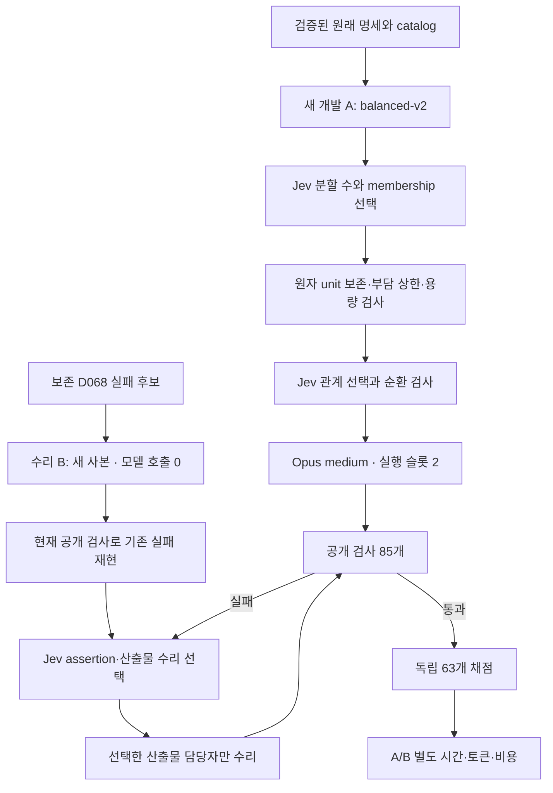

# D070 구현 — 균형 분해와 보존 후보 수리

[실험 조건](D070_EXPERIMENT.md) · [역할 계약](../agents/D070_PARALLEL.md) · [분해 담당 기록](../agents/D070_DECOMPOSITION.md) · [수리 담당 기록](../agents/D070_REPAIR.md)

목표는 같은 공개 명세를 완성하는 시간과 공식 API 환산 비용을 모두 줄이는 것이다. [실제 A/B 결과](D070_RESULTS.md)는 원래148개 검사에서 시간·비용 개선과 별도 보존 수리 성공을 확인했다. 그러나 [추가 품질 진단](D070_QUALITY_REVIEW.md)의 새A0/8·기준선각8/8로 동일 품질의 최종 목표는 미달이다. 기존 D067/D068/D069 증거와 동결된 실행 소스는 보존했다.

## 분해 정책

기존 v1의 깊이3 중단과 불균형 membership은 opt-in `balanced-v2`에서 바뀐다. 현재 catalog의 terminal 상한은 unit 6 / 요구사항 20 / artifact 6 / path 10이다. `max(ceil(total / min(unit count, max leaves, two slots × two waves)), largest atomic unit)`로 계산하며 임의의 작업 내용은 새로 만들지 않는다. 실제 leaf 수는 Jev의 합법적 선택과 재귀에 따라 결정된다.

복수 unit 묶음이 상한을 넘으면 keep를 제거한다. 선택된 자식 수의 각 배정은 `ceil(parent units / child count)`를 넘을 수 없다. 깊이3에서도 큰 묶음이 남으면 추가 분해를 허용한다. 기존 30 leaf / 59 node / 435 관계쌍 / 128 결정 호출 상한·원자 unit·두 실행 슬롯은 유지한다. 선택지 제거와 단일 선택의 로컬 처리는 실제 Jev 호출과 별도 event로 기록한다.

새 [질문 계약](contracts/adaptive-decomposition.v2.json)은 작업량·남은 용량·후속 대기와 인터페이스 언급을 영어로 제공한다. 언급 자체를 의존 관계로 확정하지 않는다. 관계 질문과 순환 검사는 기존 의미를 유지한다. 균형 정책에서는 leaf의 중복 interface를 원래 `state.units` + `unit_ids`로 정확히 복원하는지 확인하고 한 번만 넣는다. 원문을 잘라내거나 테스트를 생략하지 않는다.

진입점은 [planner](../../src/orchestration/adaptive-dag-planner.mjs), [균형 모듈](../../src/orchestration/adaptive-decomposition-balancing.mjs), [v6 manifest](../../benchmarks/e2e-swe/manifests/d070-adaptive.json)다. 이전 manifest에는 새 정책이 적용되지 않는다. 공유 catalog 준비 요청·명세·검사 정의의 일치를 재검사하며 catalog 생성 모델 호출은 추가하지 않는다.

## 실제 산출물 수리

[보존 수리 실행기](../../src/benchmark/preserved-artifact-repair-runner.mjs)는 원래 candidate의 파일 bytes/권한/artifact revision과 공개 명세·검사 정의를 확인한다. 새 runtime에 같은 파일을 복사하고 현재 공개 검사로 실패를 재현해야 새 Jev 수리 판단을 호출한다. 첫 라운드의 copy는 model implementation이 아니므로 별도 metrics에 provider 0으로 기록한다.

Jev 선택은 현재 v2 수리 입력과 직접 연결된다. 선택한 산출물만 쓸 수 있는 기존 MCP worker를 실행하고 다른 산출물을 상속한다. 재검사 이후 바뀌지 않은 산출물의 bytes/mode/revision을 검증한다. 완성되지 않은 export는 성공 보존 증거로 취급하지 않는다. 알려진 HTTP 거절은 뒤늦은 deadline 관측으로 덮지 않는다. 기존 adaptive execution loop는 변경하지 않았다.

## 측정과 한계

A는 처음부터 개발, B는 기존 실패 후보의 수리이므로 서로 다른 시작점이다. 새 [분석 helper](../../benchmark-runs/d070-analysis-tools/analyze.mjs)는 둘의 비용·시간과 실제 겹침을 분리한다. B의 짧은 수리 시간을 Claude 전체 개발 시간에 대입하지 않는다. 실제 월 구독 청구 배분은 미상이며 공식 단가 환산만 비교한다.

입력 검사는 요청당 byte·전체 토큰 추정·질문당 토큰 추정을 각각 확인한다. 수리 24,000B는 운영 한도이며 정확 tokenizer가 아니다. uncertain POST를 자동 재전송하지 않는다. hidden grader 내용은 모델·구현 분석에 제공하지 않고 완료된 후보에 대한 원래 독립 채점만 실행한다.
