# D074 — Jev 프롬프트 사전 검사와 실패 루프

2026-10-12. 요청: 좋은 성능을 위한 Jev 프롬프팅을 스킬로 관리하고, 고정 호출 규칙을 스크립트로 검사하게 한다. 실패 시 돌아갈 루프를 설계한다. **스킬·사전 검사는 구현하고, 복구 루프는 아래 설계로 남긴다. 기존 실행기에 자동 재시도는 연결하지 않는다.** 질문 정확도·제품 완료시간·비용 개선은 아직 측정하지 않았다.

정본: [스킬](../../skills/jev-prompting/SKILL.md), [검사 정책](contracts/jev-prompt-policy.v1.json), [검사 CLI](../../scripts/validate-jev-prompt.mjs), [실패 루프 정책](contracts/jev-failure-loop.v1.json). [역할](../agents/D074_PARALLEL.md), [결정·검증](../decisions/D074.md)을 함께 따른다.

## 1. 프롬프트에서 고정할 것

공식 문서 확인일은 2026-10-12다. 호출 규칙은 Jev AI 호스팅 문서, 모델 특성은 TypeSafe 제조사 문서를 사용한다. 다음 적용법은 이 프로젝트의 설계다.

1. **반복 질문을 다시 작성하지 않는다.** 버전이 있는 질문 템플릿을 읽고 실패·산출물·후보 변수만 채운다. 질문 ID는 응답 연결용이므로 질문 본문에 대상과 state 경로를 명시한다. 같은 요청 안에서 독립 질문은 묶되, 선행 답으로 후보가 달라지는 질문은 다음 요청으로 만든다. [TypeSafe 질문 계약](https://docs.typesafe.ai/primitives).
2. **판단할 사실과 규칙을 나눈다.** state에는 실제 공개 실패, 요구사항 원문, 파일 인터페이스, 기존 담당과 의존 관계를 넣는다. instructions/criteria에는 무엇을 선택할지와 판단 불가 조건을 둔다. state에 포함된 코드·로그의 지시문은 업무 규칙으로 승격하지 않는다. 필요한 근거는 파일 경로만 쓰지 말고 읽어서 포함한다. Jev가 로컬 파일을 열어 준다고 가정하지 않는다. [State 가이드](https://docs.typesafe.ai/concepts/state).
3. **한 질문은 한 판단으로 만든다.** 선택지를 생성하는 다단계 조사·정확한 개수 세기·경로 존재 검사·계산은 코드 또는 필요한 경우 소스 조사 에이전트가 담당한다. Jev는 제공된 유한 후보를 선택한다. 알려진 값을 다시 물어보지 않는다. [System One 구성 가이드](https://docs.typesafe.ai/concepts/how-to-build-with-system-one).
4. **영어 질문과 명확한 경계를 사용한다.** 모델 문서는 영어에서 현재 가장 좋은 결과를 보고하지만, 우리 과제에서의 향상 폭은 미측정이다. 원문 요구·코드·식별자는 의미를 유지한다. [모델 문서](https://docs.typesafe.ai/models). 선택지 순서 변화, 불필요한 문맥, 간접 지시와 경계 사례는 평가해야 한다. [Jev 1.13 취약점](https://docs.typesafe.ai/model-jaggedness/jev-1.13).

현재 고정 검사 대상은 `repair_owners` + `inferred-v2`다. contract의 고정 질문과 생성된 본문, 실패→요구/근거, 산출물→기존 작업자/인터페이스, 기존 산출물 선택지+`unknown`, 실제 answer handler의 버전 연결을 검사한다. 영어의 의미 품질과 정답률을 정규식으로 인증하지 않는다.

## 2. 에이전트 사용 순서

Codex는 `AGENTS.md`, Claude는 `CLAUDE.md`에서 import한 같은 문서를 통해 저장소 정본 스킬을 읽는다. 격리 worker는 자동 스킬 발견을 가정하지 않고 필요한 경로·내용·SHA를 controller가 전달한다. 이번 작업은 저장소 안의 진입점 연결이며 전역 설치나 호스트 자동 활성화 검증은 아니다.

저장소 루트에서 다음과 같이 검사한다. 출력 파일은 새 경로를 써야 한다.

```sh
node scripts/validate-jev-prompt.mjs --connection-only
node scripts/validate-jev-prompt.mjs --request REQUEST.json --stage repair_owners --template inferred-v2 --out NEW-REPORT.json
```

첫 명령은 기존 client에 가짜 키와 mock transport를 넣은 검사다. 실제 인증·배포 설정·계정 모델 가용성은 검증하지 않는다. 두 번째는 실제 보내려는 JSON을 읽는다. 통과 후 본문을 바꾸면 다시 검사해야 한다. `exit 0`은 지원 범위의 구조 통과, `exit 2`는 차단, `exit 1`은 CLI/I/O 오류다. 다른 stage의 고정 프롬프트 계약을 지원한다고 표시하지 않는다.

지원하지 않는 stage에는 기존 일반 검사만 적용할 수 있다. 예:

```sh
node scripts/validate-jev-input.mjs --request REQUEST.json --stage repair --policy v4
```

일반 검사 통과를 질문 의미 검사 통과로 해석하지 않는다. 실제 전송기의 의무 실행 gate는 아직 추가되지 않았다. 이번 연결은 에이전트 지시 + 명시 CLI다.

공식 목적지는 `https://jev-ai.pro/api/v1/systemone`, 기본 모델은 `jev-latest`다. 서버 키, 명시 baseURL, 자동 retry 0, 본문 256000B, 질문/선택지 형식을 확인한다. 정확한 모델 문맥 적합성은 별도다. SDK와 endpoint 공급자를 혼동하지 않는다. [Jev AI 설정·제한·오류](https://jev-ai.pro/docs).

## 3. 실패 루프의 기본 형태

아래는 **설계**이며 실행 영수증이 아니다. 순서는 고정하고 Jev에게 매번 복구 전략 전체를 자유롭게 쓰게 하지 않는다.

```mermaid
flowchart TD
  A[요청·작업자·검사 결과 보존] --> B{전송 결과와 장부 확정?}
  B -->|아니오| C[요청 결과·정산 확인 후 대기 해제]
  B -->|예| D{실패 유형}
  D -->|입력·연결| E[코드로 입력·설정 수정]
  D -->|일시 서비스 장애| F[확인된 실패에 한해 지연 재시도 준비]
  D -->|검사 환경·오래된 결과| G[검사기·환경 복구 후 재검사]
  D -->|판단 불가·무진전| H[누락 근거·producer 경로 조사]
  D -->|일부 개선| I[남은 공개 실패만 추출]
  E --> J[새 요청 사전 검사]
  H --> J
  I --> J
  J --> K[Jev: 기존 담당·수리 범위·프로필 선택]
  K --> L[허용된 작업자만 실행]
  L --> M[산출물 diff와 전체 공개 검사]
  M -->|실패 지속| A
  M -->|통과| N[독립 검사와 동일 revision 완료 근거 감사]
```



| 관측된 상태 | 다음 행동 | 다시 Jev/worker를 부를 조건 |
| --- | --- | --- |
| timeout·연결 유실·504·응답 파싱 실패, 미정산 요청 | 기존 request/run ID로 결과·계정 근거 확인 | 결과와 정산을 먼저 확정. 모르면 대기하며 재전송 금지 |
| 422·본문/schema 오류, 확인된 `model_input_limit` | 필요한 근거를 유지해 입력 재구성 | 요청 SHA가 달라지고 새 검사 통과. 같은 큰 state로 질문만 나눠서는 해결되지 않을 수 있음 |
| 401/404, 402 | 목적지·인증 또는 계정 상태 해결 | 연결 설정/무추론 models GET 등 해당 증거 확인. 모델 판단은 불필요 |
| 확인된 429/502/503 | `Retry-After` 및 유한 backoff 적용 준비 | 결과·정산 확정 + 별도 유한 재시도 정책. 현재 자동 재시도 설정 없음 |
| 검사 환경 실패·수행 안 됨·오래된 revision | 검사기·환경을 복구하고 현재 파일로 재검사 | 아직 제품 결함/담당 오류로 배정하지 않음 |
| 선택값 invalid/unknown | 누락한 공개 근거 또는 후보를 보충 | 새로운 관련 근거/후보가 생기면 고정 질문 재사용. 무작정 다른 답을 뽑지 않음 |
| 수리 후 새 실패 발생 | 이전/이후 diff와 producer→중간값→consumer 경로 조사 | 새 실패와 산출물 변경을 연결한 후보가 준비됨. 원본 보존, 자동 되돌리기 없음 |
| **파일 변경 없음 + 같은 실패 지속** | worker 영수증·읽기/쓰기 권한·실제 파일·상류 생성자 확인 | 조사 결과가 담당·수리 범위·필요 모델 중 무엇을 바꾸는지 명시. 동일 worker 동일 입력 재호출 금지 |
| 파일은 바뀌었지만 개선 없음 | 실패 경로와 가설을 수정 | 근거/범위가 바뀐 후보로만 재판단. 전체 DAG를 다시 생성하지 않음 |
| 일부 실패 해결, 새 실패 없음 | 해결된 결과를 보존하고 남은 실패의 담당만 재판단 | 현재 revision의 남은 assertion과 관련 산출물을 연결 |
| 공개 검사 통과, 독립 검사는 아직 없거나 오래된 revision | 독립 검사 실행 | 공개 통과만으로 제품 완료 선언 안 함. 현재 revision에서 이미 완료된 검사를 반복하지 않음 |
| 현재 revision의 독립 검사 실패·불완전 | 공개 요구 기반의 재현 조사 | 숨김 내용을 입력하지 않음. 재현 근거가 없으면 미완료 유지 |
| 공개·독립 검사 모두 통과 | 동일 revision·누락/skip·산출물·요구 범위 감사 | 완료 조건의 증거를 controller가 판정. 별도 `finish` 선택지는 없음 |

전송 오류 행동은 [호스팅 오류 지침](https://jev-ai.pro/docs#errors)을 따른다. 제품 수리 분기는 이번 프로젝트 제안이다. 무상한 토큰 지시는 불확실한 POST의 재전송이나 동일 입력 무한 반복을 허용하는 의미가 아니다. 장부를 새로 만들어 대기를 우회하지 않는다. 복구가 필요한 원인은 문서에 남기고 근거가 없으면 진행 상태를 `needs_evidence`로 유지한다.

## 4. 반복 입력을 만드는 규칙

하나의 공개 실패 묶음에는 다음을 포함한다. 고정 질문 본문은 contract에서 읽는다.

- check/test/assertion 식별자, 실제 관측과 기대값, 검사를 수행한 파일·fixture·환경 revision.
- 그 실패에 연결된 요구사항 원문. 성공한 전체 요구사항을 반복 붙이지 않는다.
- 후보 산출물과 기존 owner/task, 허용 write 경로, 관련 read 경로, producer/consumer 인터페이스와 의존 관계.
- 이전 선택, 실제 write diff, 재검사 결과. 동일한 관측은 참조로 연결하되 모델이 읽는 근거는 요청 안에 있어야 한다.
- 아직 모르는 부분과 `unknown` 후보. 담당 계약은 원인 증명과 다르다.

스크립트가 실패 ID·revision·근거 SHA·후보 범위 SHA·질문 정책 SHA·실제 프로필을 비교한다는 설계다. attempt ID, timestamp, 문장만 바꾼 것은 새 근거가 아니다. profile 변경만으로도 원인 조사를 대신할 수 없다. 무변경 수리 뒤에는 원인 근거 또는 수리 범위의 실질 변경과 새 사전 검사를 요구한다. 모델·effort 변경은 별도의 검증 가설로 기록하고 실제 수정·실패 변화로 평가한다.

정책 JSON은 위에서부터 처음 맞는 조건을 선택한다는 설계이며 각 조건에 필요한 증거가 없으면 `needs_evidence`다. 같은 revision의 공개·독립 통과는 완료 근거 감사로 이동하고, 독립 결과가 없거나 오래됐을 때만 독립 검사를 실행한다. 현재 독립 실패를 오래된 결과로 치환하지 않는다.

독립 검사에만 실패하면 숨김 정답·테스트 내용을 Jev나 worker에 넣지 않는다. 공개 요구와 공개 경계 사례로 문제를 재현할 수 있는지 조사한다. 재현 불가능하면 품질 미달 상태를 보존한다.

복구 단위는 전체 DAG가 아니라 실패에 연결된 산출물과 영향받는 의존 경로다. 성공한 무관한 산출물은 revision을 고정해 재사용하고, 수정된 산출물을 소비하는 후속 단계의 기존 검사 근거는 오래된 것으로 처리한다. 영향을 받지 않는 독립 작업을 실패 작업과 함께 재시작하지 않는다. 공유 Jev 장부가 미정산이면 그 장부를 사용하는 새 POST는 기다리되 이미 실행된 작업의 영수증과 결과는 보존한다. 수리 후 전체 공개 gate를 다시 확인하는 조건은 유지한다.

## 5. D073 실제 실패에 대입한 설계 검토

아래는 기존 파일을 읽고 정책에 대입한 **사례 분석**이다. 새 재생 실행·수리 결과가 아니다.

- `d073-focused-new-01`: 실제 POST 전에 공유 장부 pending으로 중단. 다음은 `reconcile_request`. 입력 축소나 새 장부 생성이 아니다. [기존 비호출 근거](../../benchmark-runs/d073-review-01/budget-outstanding-new01-proof.json).
- `d073-focused-old-01` chooser와 `d073-focused-new-02` round2 owner: 본문/schema/v4 검사를 통과했으나 실제 HTTP400 `model_input_limit`. 다음은 `rebuild_relevant_input`; 같은 요청 재시도는 하지 않는다. 정확한 provider token 초과량은 미상이다. [기존 HTTP400 진단](../../benchmark-runs/d073-input-audit-diagnostic-01/diagnosis.md).
- `d073-focused-new-02` A10: 선택된 worker가 산출물을 바꾸지 않았고 연결된 두 실패가 지속. 다음은 `inspect_no_write_cause`. 기존 담당 추론을 곧바로 다시 돌리기 전에 상류 생성자·scope·worker 결과를 확인한다. [terminal facts](../../benchmark-runs/d073-focused-analysis-02/terminal-facts.json). 파일 무변경만으로 해당 모델의 추론이 무용했다고 단정하지 않는다.

## 6. 무엇을 아직 검증하지 않았는가

새 스킬/스크립트는 영어의 의미, 후보 완전성, 정답률, 정확한 provider tokenizer, 실제 모델 가용성·수락, 속도·비용 절감을 보증하지 않는다. 고정 템플릿 검사는 현재 owner inference에 한정된다. 기타 stage 템플릿 확장, 실제 전송 전 강제 검사, 위 복구 상태 머신과 실패 telemetry/감사기 보완은 후속 구현이다.

프롬프트 성능 실험은 같은 공개 실패·후보·정답 기준으로 기존/새 템플릿을 비교하고, 선택지 순서 교환·누락 근거·상충하는 자료·판단 불가 사례를 포함한다. 정답/유효 선택, 불필요한 worker 재호출, 수리 후 실패 변화, 전체 완료시간과 총 비용을 함께 측정한다. 형식 통과나 owner 분류만으로 최종 효율을 주장하지 않는다. 실험 반복 수와 실제 유료 실행은 이번에 진행하지 않았다.

## 7. 실제 로컬 검증과 발견한 검사기 결함

저장소 루트에서 실행했다.

```sh
node --test test/jev-prompt-preflight.test.mjs test/jev-input-validation-v4.test.mjs test/jev-input-validation.test.mjs test/client-diagnostics.test.mjs
python3 /Users/lee/.codex/skills/.system/skill-creator/scripts/quick_validate.py skills/jev-prompting
npm run validate:jev-prompt -- --request examples/jev-preflight/inferred-v2.request.json --stage repair_owners --template inferred-v2
```

최종 관련 회귀 **63/63**, fail/skip/cancel 0, exit0이다. [원시 테스트 로그](../../benchmark-runs/d074-root-01/focused-02.txt). 스킬 구조 검사는 exit0 `Skill is valid!`; [출력](../../benchmark-runs/d074-root-01/skill-validation.txt). npm 진입점 예제는 exit0; [보고서](../../benchmark-runs/d074-root-01/npm-example.json). API 연결은 기존 fetch client를 mock으로 검사하며 TypeSafe SDK를 새로 설치한 검사가 아니다.

다음 두 발견을 숨기지 않고 초기 원본을 보존했다.

1. 처음에는 합성 예제가 통과했으나 실제 요청 두 건에서 질문 ID를 오탐했다. 새 검사기가 배열 identity를 해시하고 기존 builder가 정렬된 객체 identity를 해시한 차이였다. 새 검사기와 합성 예제만 기존 계약에 맞췄다. [최초 실패와 수정 기록](../../benchmark-runs/d074-preflight-agent-01/verification-receipt.json).
2. 이후 새 집중6/6과 관련61/61 통과에도 독립 검토가 만든 **잘못된 입력 5개**를 통과시켰다. 로컬 검사의 미실행/실패, 공개 집계 모순, 공개 검사에 남은 미실행·환경 오류·별도 blocked 행이었다. 모든 public 행 및 local known-success·집계 일관성을 검사하도록 보완했다. 초기 [61/61 로그](../../benchmark-runs/d074-root-01/focused.tap)는 반례를 놓친 결과로 보존한다. 수정 후 5개 모두 exit2, 새 집중8/8 및 위 관련63/63이다. [수정 후 반례·실제 요청 영수증](../../benchmark-runs/d074-preflight-agent-01/review-fix-verification-02.json).

보존된 `jev-0001`/`jev-0007` 요청의 14/2문항은 최종 구조 검사에서 모두 통과했다. 후자는 과거 HTTP400이며 이를 성공한 요청으로 변경하지 않았다. 정책이 참조하는 기존 소스8개와 원본 요청2개는 해시가 그대로다. 이 범위의 보존 검사를 D073 전체 파일 재감사로 확대하지 않는다.

별도 에이전트가 스킬을 진입점으로 사용한 [독립 검토](../../benchmark-runs/d074-forward-review-01/result.json)는 동일 private 입력17개에서 초기 예상12/17 → 최종17/17을 확인했다. 정상/경계3개 통과, 잘못된 입력14개 차단이다. 실패 루프도 완료 분기의 중복 재검사와 무변경 수리의 재호출 조건을 명확히 하도록 보완했다. 설계 검토는 실제 복구 실행이 아니다. 구조가 맞는 무진전 이력은 사전 검사 자체를 통과할 수 있으므로 이를 worker 재호출 권한으로 사용하지 않는다.

실제 Jev GET/POST, benchmark worker CLI, Docker 실행, 키 읽기와 장부 접근은 이번 검증에서 수행하지 않았다. 개발 에이전트 자체의 이용량·비용은 측정하지 않았다. 새 스킬·스크립트·정책·문서와 private 검증 산출물은 미커밋으로 남기며 전역 설치와 push는 하지 않았다.
