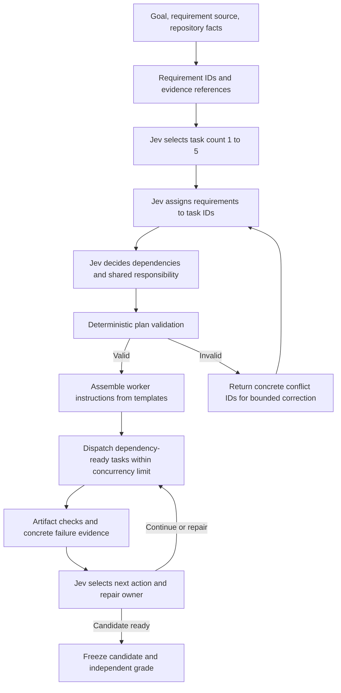

# Jev-driven task decomposition — design and test plan

Date: 2026-10-10. Status: proposed architecture, not implemented or measured.
User direction: consider both the decomposition structure and its comparison tests.
Goal: improve verified whole-task completion time and cost by moving repeated planning decisions to Jev.

## Boundary

Requirements preparation preserves source text and assigns stable IDs and acceptance criteria. It must not preassign worker roles, groups, or task boundaries. Existing files and interface facts are evidence, not predetermined task ownership. Missing architecture or acceptance criteria are explicit gaps; generating them is a separately measured preparation stage. Typed decision answers cannot be represented as free-form task generation.

## Structure

The next-action vocabulary, correction bound, decomposition depth and probability policy remain to be specified before inference. No implicit automatic retry is authorized by this design. A single available assignment bypasses Choice inference. Child decomposition must replace a parent execution obligation rather than execute both parent and children. Track leaf count separately from per-node fanout: 1–5 per node is not a global worker limit.

## Data contracts to implement

- Requirement: ID, exact source/ref, acceptance check, constraints, known interfaces, unresolved gaps; no assigned group at preparation time.
- Decision input: requirement table, current repository evidence, worker capabilities, concurrency limit, decision revision and prior concrete conflicts.
- Plan: task IDs, requirement ownership, file ownership, input/output interfaces, dependencies, check IDs, parent IDs and provenance for every assignment.
- Worker instruction: assembled from the plan and shared templates; no new planning-model paraphrase per worker by default. Any generated design work is separately logged.
- Failure: stable issue ID, observed versus expected behavior, check result, affected artifacts, evidence reference. Review cannot manufacture a confirmed defect from an unexecuted check.

File/interface discovery requires explicit treatment for new projects: Jev cannot invent arbitrary paths through a fixed Choice vocabulary. Any helper that proposes paths/interfaces is recorded as design generation with its own time and cost.

## Structural tests before inference

1. Every requirement is assigned exactly once to an accountable owner; shared consumers are separate references. Reject omitted/unknown IDs and empty tasks.
2. Reject cyclic dependencies, conflicting file writes, impossible interfaces and references to nonexistent tasks.
3. Assert deterministic instruction assembly preserves acceptance criteria, constraints and source references.
4. Prove dependency-ready dispatch never exceeds concurrency and never starts dependent work before its prerequisites are accepted.
5. Exercise malformed answers, single-option bypass, correction-bound exhaustion and uncertain provider outcomes without replay.
6. Verify recursive splits preserve parent requirement coverage, terminate within explicit bounds and never dispatch duplicate parent/child work.
7. Include a negative control where syntax passes but generated behavior fails; distinguish passed, failed, not applicable and not run.

## Matched comparison

Primary arms:
- Existing prepared-plan candidate selection.
- Jev count, requirement assignment and dependency decisions without prepared groups.

Use the same goal, acceptance criteria, repository snapshot, worker model/effort, artifact tools, verifier and resource limits. Run in isolated directories; do not touch the original Personal OS. Capture all preparation/planning cost, even when reused: report cold-start totals and amortized repeated-use totals separately. Do not silently grant one arm free planning.

Start with one diagnostic pair, then predeclare a replicated comparison before making performance claims. Include dependent, parallelizable and shared-interface tasks; a single easy task cannot establish general efficiency. Randomize or counterbalance order and report host/provider contention when arms run concurrently. Keep hidden grader feedback out of worker inputs.

Measurements:
- Independent test pass count/total and complete-task success.
- Goal receipt to graded outcome, plus separate preparation, decision, queue, execution, repair and grading durations.
- All calls and provider-reported token categories; API-equivalent estimate separately from actual billing and monthly subscription allocation. Unknown values remain null.
- Missing assignments, ownership/dependency conflicts, correction and reassignment counts, repair attempts and stop reasons.
- Actual overlap of worker execution intervals, critical-path completion, and waiting time; selected task count is not evidence of parallelism.
- Decision probabilities and observed outcomes for later calibration analysis; a probability is not a measured speedup or correctness rate.

D051 is historical context, not a matched new-arm baseline after architecture changes. Failed attempts remain in totals. Faster incomplete work is not a successful efficiency result.

## Implementation and execution gates

Next implementation: requirement/plan schemas and validators, typed decomposition questions, deterministic instruction builder, scheduler integration, then offline negative tests. Freeze exact question contracts and source versions before any new live comparison. Existing budget ledger and provider uncertainty handling remain in force. This document starts no calls or workers.

Evidence: [D051 results](D051_RESULTS.md), [current lifecycle contract](contracts/lifecycle.v1.json), [official API documentation](https://jev-ai.pro/docs). API shape was checked on 2026-10-10; proposed workflow effectiveness is unmeasured.
