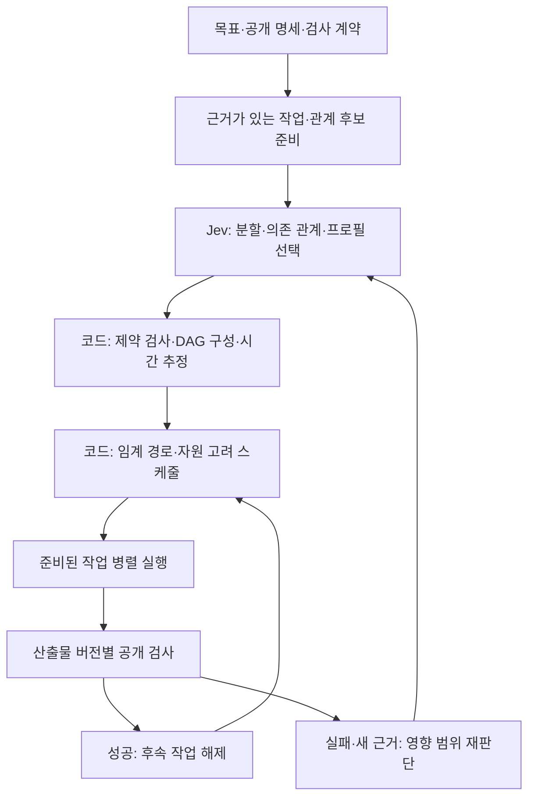

# Jev 의존성 기반 에이전트 개발 시스템 설계

작성일: 2026-10-10 (Asia/Seoul). 작성 주체: 메인과 분리된 사이드 대화.
상태: **설계 제안. 구현·실제 Jev 호출·효율 측정은 수행하지 않음.**

## 사용자 요청과 범위

사용자는 컴파일러의 의존성 기반 스케줄링·임계 경로 분석을 작업 개발에 적용하고자 한다.
Jev 호출로 작업 분할과 관계를 판단하고, 의존성·예상 소요·병렬 실행 가능성을 단순하게 파악하는 시스템을 원한다.
이 구조를 문서로 남겨 메인에 먼저 전달하고, 사용 전 준비와 역할 분배를 조사·설계하도록 요청했다.
본 문서는 그 요청의 기록이며 아래 세부 구현 정책까지 사용자 확정으로 간주하지 않는다.

이번 사이드 작업은 새 문서만 작성한다. 메인 코드, 공용 STATE·결정 인덱스, 기존 실험·장부는 변경하지 않는다.
메인 작업의 D 번호를 선점하지 않고 독립 문서 이름을 사용한다.

## 핵심 구조

1. **분해 트리:** 목표 → 기능 → 실행 가능한 작업. 작업이 무엇에 속하는지 표현한다.
2. **실행 DAG:** 검증된 선행 산출물이 있어야 다음 작업을 시작할 수 있다는 관계를 표현한다.
3. **충돌·자원 제약:** 같은 파일 쓰기, 공용 환경, 동시 실행 슬롯 등을 별도로 표현한다.

트리의 형제라고 독립 작업은 아니다. 같은 파일을 쓴다고 항상 의미적 선행 관계가 생기지도 않는다.
동일한 task ID를 세 관점에서 재사용하고, 화면은 하나의 작업 목록과 연결된 그래프로 보여준다.

위 흐름도는 제어 루프다. 각 실행 계획 버전 내부의 의존성 그래프는 순환이 없는 DAG여야 한다.
실패 후 수리는 새 시도 또는 새 계획 버전으로 표현한다.

## 책임 배분 제안

- 메인: 목표·범위·품질 기준·예산 정책·최종 통합 책임.
- 준비 담당: 원문 요구사항, 후보 작업, 산출물 계약, 실행 가능한 검사 목록을 준비한다. 자유문 생성이 필요하면 이 단계에서 수행한다.
- Jev: 문서에 미리 정의한 영어 질문과 허용 후보로 분할·관계·프로필을 선택한다. 반환값은 등록된 처리 함수에 연결한다.
- 결정론적 컨트롤러: 후보·용량·의무 보존·순환을 검사하고, 시간 추정·임계 경로·자원 예약·실행·해제를 계산한다.
- 작업자: 배정된 산출물과 공개 검사 증거를 제출한다.
- 검증 담당: 코드 종료만으로 후속을 열지 않고, 요구된 산출물의 정확한 버전에 검사를 연결한다.
- 관측 담당: 계획·대기·실행·수리·검증 시간과 사용량을 읽기 전용으로 집계한다.

역할은 책임의 분리다. 모든 역할마다 새 LLM 세션을 만드는 설계가 아니다.
이 사이드 작업에서는 서브에이전트를 생성하거나 기존 에이전트에 접근하지 않는다.

## Jev에 맡기는 판단과 코드로 계산할 내용

Jev에는 “B가 A의 어떤 산출물을 필요로 하는가”, “이 요구사항 묶음을 어떤 경계로 나누는가”,
“현재 후보 중 어느 모델·노력도 프로필이 적합한가”를 묻는다.
코드는 검증된 입력을 이용해 준비 작업 목록, 최장 의존 경로, 시작 가능 시각, 파일 충돌과 슬롯을 계산한다.

Jev가 자유 형식의 새 작업 설명을 바로 생성한다고 가정하지 않는다.
작업 후보와 요구사항 원문을 준비하고 typed decision을 조합해 그래프를 구성한다.
판단 근거가 부족한 관계는 `unknown`으로 남기며 독립 관계로 자동 치환하지 않는다.

소요 시간은 이력에서 같은 작업 유형·모델·노력도 조건의 관측값을 사용한다.
이력이 없으면 추정 근거 또는 `unknown`을 표시한다. Jev 점수를 곧바로 초 단위로 해석하지 않는다.
임계 경로는 주어진 시간 추정과 의존성에서 계산한 하한이다. 자원 제약을 포함한 전체 완료 시간과 구분한다.

## 현재 메인과 연결할 지점

2026-10-10에 로컬 문서 [D061](../D061_MAX_WORKERS.md), [D062](../D062_LIVE_PLAN.md)를 읽었다.
현재 문서에는 최대 작업자 수와 실제 동시성이 분리되어 있고, 최신 실제 계획에서 배정 용량 위반으로 계획이 실패했다고 기록되어 있다.
원본 실험을 이번 사이드 작업에서 재실행·재집계한 것은 아니다.

따라서 새 설계에서는 용량을 사후 자연어 검사에만 맡기지 않고 **허용되는 선택지 생성 단계에서 용량과 의존성 제약을 적용**한다.
실제 공개 검사 연결과 공유 검사 준비 조건을 먼저 마련한다. 병렬화를 늘리기 전에 산출물 경계가 분리되는지 확인한다.
기존 실험 원본과 실행기는 보존하고, 새 조건의 효과는 별도 비교로 측정한다.

## 문서 읽는 순서

1. [메인 인계](HANDOFF.md): 채택할 방향, 현재 장애물, 문서 작성·전달 상태.
2. [상세 아키텍처](ARCHITECTURE.md): 필드, 영어 질문 정본, 선택값→handler, 용량, 재귀·DAG·시간 계산.
3. [사전 준비와 역할](PREPARATION_AND_ROLES.md): 실행 검사 mapping, 산출물 계약, 모델·자원, 개발 역할과 인계.
4. [공식 조사·비교 실험](RESEARCH.md): 출처·전이 한계, 오프라인 반례, 조건별 비교, 지표·산식.
5. [독립 설계 기록](../../decisions/DAG-SIDE-20261010.md): 요청·검증 근거·미완료·부수 효과.

현재 질문 초안은 ARCHITECTURE §4.2에 있다. 제안된 JSON 계약 파일은 아직 생성하거나 실행기에 연결하지 않았다.
메인은 이 문서를 설계 인계 진입점으로 사용한다. 구현이나 유료 재실행을 이 문서만으로 자동 시작하지 않는다.

## 확인 수준과 다음 단계

- 확인한 것: 사용자 의도, 로컬 최신 설계·결과 문서, Jev 공식 typed API와 Python graphlib의 준비 작업 처리 방식.
- 아직 확인하지 않은 것: 이 구조의 실제 실행, 정확한 의존 관계 판정 품질, 전체 개발 완료 시간·비용의 개선.
- 다음 작업: 실행 가능한 검사 mapping과 artifact 계약부터 준비하고, 오프라인 실패 대조 사례를 거쳐 새 조건의 실제 개발 비교를 구성한다.

초기 공식 출처: [Jev API](https://jev-ai.pro/docs), [Python graphlib](https://docs.python.org/3/library/graphlib.html).

메인 전달: 지정 대화 전송 도구의 두 번의 시도가 같은 오류로 실패했다. UI 대체 접근도 제한되어 메시지 전달은 미완료다.
이 디렉터리는 메인과 공유하는 로컬 파일 경로에 저장되었지만, 메인이 읽거나 채택했다고 주장하지 않는다.
